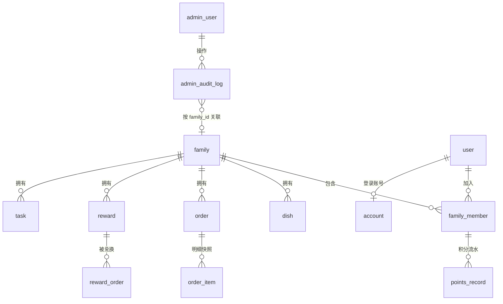

# 管理后台（admin-console）- 产品模块设计文档

## 基本信息

- 模块名称：管理后台（admin-console）
- 版本：v1.0
- 创建日期：2026-11-23
- 负责人：product-designer skill
- 任务 ID：20261123-003
- 所属项目：jiawei（家味小札）

## 需求摘要

> 用户原始需求：针对现在的项目，完成管理后台的需求设计，对家庭、菜品等管理
>
> 需求解读：为平台运营者（项目所有者本人）提供一个独立的 Web 管理后台，跨家庭查看和管理家庭、菜品，并覆盖用户与账号、订单与兑换记录、任务 / 积分 / 奖励商品、AI 地域推荐运维。后台账号与小程序 / H5 业务账号隔离。高危操作需二次确认并写入审计日志。

## 范围说明

- **包含**：管理员登录与会话；家庭管理；菜品管理；用户与账号管理；订单与兑换记录管理；任务（只读）/ 积分流水与手动调整 / 奖励商品管理；AI 地域推荐运维；审计日志与高危操作控制。
- **不包含**：
  - 后台前端的具体页面布局与视觉设计（后续由 page-layout-designer 处理）。
  - 多角色分级与权限矩阵（已确认单一超级管理员）。
  - 家庭物理删除（仅做"注销"，即 `family.status = 0`）。
  - 城市列表（`server/src/data/cityList.ts` 为代码内静态数据）的在线编辑。
  - 代替家庭新建菜品、任务、奖励（Q7 已确认不做）。
  - 对现有业务端接口的功能改动，前置改造见本文"现有系统约束与前置改造"。

**优先级含义**：P1 / P2 / P3 表示第一期内的实现先后，不表示是否做。第一期共覆盖 6 类管理对象，P1 先做，P2 随后，P3 视情况。

## [已确认] 清单

| 项 | 结论 | 来源 |
|---|---|---|
| 使用者 | 平台运营（项目所有者本人） | 范围确认交互 |
| 承载形态 | 仓库新增独立 Web 项目 `admin/`，`server` 新增 `/api/admin` 路由 | 范围确认交互 |
| 第一期管理对象 | 家庭、菜品、用户与账号、订单与兑换记录、任务 / 积分 / 奖励商品、AI 地域推荐运维 | 范围确认交互 |
| 管理员账号体系 | 独立 `admin_user` 表，独立 JWT，与业务 token 隔离 | 角色确认交互 |
| 角色分级 | 单一超级管理员 | 角色确认交互 |
| 高危操作 | 允许执行，二次确认，写入审计日志 `admin_audit_log` | 角色确认交互 |

## 待确认事项的决议（Q1–Q11，2026-11-23 已逐项确认）

| 编号 | 问题 | 决议 |
|---|---|---|
| Q1 | 初始管理员账号如何创建 | 命令行脚本创建，不开放注册接口 |
| Q2 | 管理员 token 有效期、是否续期 | 8 小时，不续期 |
| Q3 | 禁用用户、重置密码后，业务 token 是否立即失效 | 禁用：`authRequired` 校验 `user.status`，立即失效（D1 已确认并已实施）。重置密码：不强制失效 |
| Q4 | 高危操作二次确认是否重新验密 | 前端确认弹窗 + 必填原因，不重新验密 |
| Q5 | 审计日志保留期；失败操作是否记录 | 保留 1 年，仅记录成功的操作。过期清理方式见下方遗留项 |
| Q6 | 菜品 `category` 是否限定枚举 | 不限定，沿用现有代码（≤32 字） |
| Q7 | 平台是否可替家庭新建菜品 / 奖励 | 不可。仅编辑、上下架、删除；F3.7 不实施 |
| Q8 | 家庭物理删除、转让房主 | 都不做 |
| Q9 | 已成功的地域推荐能否强制重新生成；同步还是异步 | 仅失败或无记录的地域可重试，单地域同步等待 |
| Q10 | 后台前端技术栈、部署域名、CORS 白名单 | 技术栈：React + TypeScript + Vite。域名与 CORS 白名单仍未定 |
| Q11 | 平台能否修改任务、奖励内容 | 任务只读，奖励仅上下架和删除 |

## [待确认] 遗留项

| 编号 | 问题 | 本文暂定做法 |
|---|---|---|
| R1 | 后台部署域名、CORS 白名单来源、是否多进程部署（来自 Q10 未定部分） | 未定。多进程会使 F7 的进程内互斥失效 |
| R2 | 审计日志超过 1 年后的清理方式（来自 Q5） | [建议] 提供命令行清理脚本，按 `created_at` 删除 1 年前记录，由人工或定时执行 |
| R3 | 登录失败锁定阈值 | 暂定 5 次失败锁定 15 分钟 |

## 现有系统约束与前置改造

以下内容来自对 `server/` 代码的阅读，不是推测。

### 已核实的现状

| 编号 | 现状 | 位置 | 对后台的影响 |
|---|---|---|---|
| C1 | `JwtPayload` 只有 `userId`、`nickname`，签发与验证共用 `config.jwt.secret` | `server/src/types/api.ts`、`server/src/utils/jwt.ts` | 后台 token 必须用独立密钥，否则业务 token 可能被当作后台 token |
| C2 | `authRequired` 只验签，不查 `user.status`。`login` 只在登录当下检查 `user.status` | `server/src/middlewares/auth.ts`、`authService.ts` | 禁用用户后，已发出的 token 在过期前仍可调用接口 |
| C3 | `requireMember` / `requireAdmin` 不检查 `family.status`。只有 `getUserFamilies`、`getFamilyDetail` 过滤 `status = 1` | `permissionService.ts` | 家庭注销后，成员仍可直接调用菜品等接口 |
| C4 | 菜品删除是硬删除 `DELETE FROM dish`。`order_item` 有名称、价格快照。`reward.dish_id` 无外键 | `dishService.ts` | 删除被奖励引用的菜品会留下悬空引用 |
| C5 | `adjustPoints` 在事务外读取余额，事务内直接写入，没有 `FOR UPDATE`。其注释声称同步 `user.points`，实际只更新 `family_member.points` | `pointsService.ts` | 后台调积分不能复用该函数，需要带行锁的新实现 |
| C6 | `resetPassword` 只凭账号名即可重置，没有验证码 | `authService.ts` | 业务端既有风险，不属于本需求，但建议另立任务处理 |
| C7 | 积分以 `family_member.points`（按家庭隔离）为准。`user.points` 未被登录与汇总使用 | `authService.ts` | 后台展示和调整积分只针对 `family_member.points` |
| C8 | `cancelOrder` 取消 `pending / confirmed` 订单，归还库存，退还已扣积分。`reward_order` 撤销仅限 `pending`，退积分和库存 | `orderService.ts`、`rewardService.ts` | 后台强制取消沿用同样规则，不另造规则 |
| C9 | `deleteReward` 在已有兑换记录时拒绝删除 | `rewardService.ts` | 后台沿用同样规则 |
| C10 | `generateForRegion` 对已有 `success` 记录直接返回。对 `failed` 会先删占位行再重试。定时任务在进程内用 `setTimeout` + `setInterval`，无手动触发入口 | `regionRecommendationService.ts`、`regionRecommendationCron.ts` | 后台"重新生成"只能覆盖失败或无记录的地域，强制覆盖成功记录需新增逻辑（Q9） |
| C11 | CORS `origin: '*'`；成功响应 `{code: 0}`，`res.fail` 返回 HTTP 200 + `code: -1`；`authRequired` 失败返回 HTTP 401 | `app.ts`、`response.ts` | `/api/admin` 需收紧 CORS（Q10）；响应格式沿用 |
| C12 | 无迁移工具。schema 来源是 `server/docs/jiawei_db_schema.sql`，增量放在 `server/docs/migrations/`，命名 `YYYYMMDDNN_xxx.sql` | `server/docs/DATABASE.md` | 新表需新增迁移脚本 `2026112303_admin_console_v1.0.sql`，并同步更新建库脚本与 `DATABASE.md` |

### 前置改造（后台功能生效所依赖的业务端改动）

| 编号 | 改造 | 原因 | 关联功能 |
|---|---|---|---|
| D1 | `authRequired` 增加 `user.status = 1` 校验，可加短时内存缓存 | C2：否则"禁用用户"对已登录用户无效 | F4 |
| D2 | `requireMember` 增加 `family.status = 1` 校验 | C3：否则"注销家庭"对成员无效 | F2 |
| D3 | 新增 `ADMIN_JWT_SECRET` 配置与 `adminAuthRequired` 中间件 | C1：与业务 token 隔离 | F1 |
| D4 | `/api/admin` 使用独立的 CORS 白名单 | C11 | F1 |
| D5 | 新增 `admin_user`、`admin_audit_log` 两张表及迁移脚本 | C12 | F1、F8 |
| D6 | 抽取 `cancelOrder`、`cancelRewardOrder` 的事务核心为不校验成员身份的内部函数，供后台复用 | C8 | F5 |

D1、D2 会改变业务端现有行为（被禁用用户和已注销家庭的成员将收到错误）。这是后台功能成立的必要条件，实现前需用户确认。

## 角色矩阵

| 角色 | 职责描述 | 权限范围 | 关联功能 |
|---|---|---|---|
| 平台超级管理员 | 后台唯一使用者，管理全部家庭和数据 | 后台所有查询与写操作，包括高危操作，均需登录后台账号。无角色分级 | F1–F9 |
| 业务端用户（家庭 owner / admin / member） | 小程序 / H5 的使用者，是被管理对象 | 不能登录后台，后台 token 与业务 token 互不通用 | 无（受 F2、F4 的操作影响） |
| 定时任务（系统） | 每日 03:00 为各地域生成三餐推荐 | 由服务进程内部触发，不经后台 | F7（被运维对象） |
| AI 服务（外部系统） | 生成三餐推荐文本 | 由 `aiService` 调用，后台只能间接触发 | F7 |

角色规则：

- 后台没有注册入口，管理员账号只能由脚本创建（Q1）。
- 后台 token 不能访问业务接口，业务 token 不能访问 `/api/admin`。两者密钥不同，且后台 token 带 `aud: 'admin'`。
- 管理员在后台执行的操作不依赖其在任何家庭里的成员身份。

## 功能树

通用规则（所有功能适用）：

- **GR1** 所有 `/api/admin` 接口（登录除外）需通过 `adminAuthRequired`，未登录返回 HTTP 401。
- **GR2** 所有写操作都写入 `admin_audit_log`，且与业务变更在同一事务内提交。
- **GR3** 高危写操作（见 F8 清单）必须带 `reason`（4–200 字），前端需弹窗二次确认。
- **GR4** 所有列表接口分页：`page` 默认 1，`pageSize` 默认 20、最大 100，返回 `{list, total, page, pageSize}`。
- **GR5** 响应格式沿用现有约定：成功 `{code: 0, message, data}`，业务错误 `{code: -1, message, data: null}`。
- **GR6** 手机号在列表中脱敏为 `138****0000`，详情页显示完整号码。

### F1 管理员登录与会话 [P1]

- F1.1 登录 [P1]
- F1.2 获取当前管理员信息 [P1]
- F1.3 修改密码 [P1]
- F1.4 登出 [P1]（前端清除 token，服务端无状态）

**描述**：唯一入口。管理员用用户名和密码登录，获得 `aud: 'admin'` 的 JWT。
**触发**：打开后台、token 过期、手动登出。
**主流程**：输入用户名、密码 → 校验 → 签发 token → 进入后台。
**分支**：连续失败触发锁定；管理员被禁用。
**异常**：账号或密码错误、账号锁定、账号禁用、token 无效或过期。
**前置条件**：`admin_user` 中已有账号（由脚本创建，Q1）。
**后置状态**：`last_login_at` 更新；写入审计 `auth.login`。

**业务详细描述**

- **业务规则**
  1. 用户名 3–32 位字母、数字、下划线。密码 8–64 位，需同时含字母和数字（暂定）。
  2. 错误提示统一为"账号或密码错误"，不区分账号不存在或密码错误。
  3. 连续失败 5 次，锁定 15 分钟（`failed_count`、`locked_until`，暂定参数）。成功登录后清零。
  4. 密码哈希复用现有 `utils/password` 的 `salt:hash` 方案。
  5. token 载荷：`{adminId, username, ver, aud: 'admin'}`，用 `ADMIN_JWT_SECRET` 签名，有效期 8 小时（Q2）。
  6. `adminAuthRequired` 每次请求查询 `admin_user`，校验 `status = 1` 且 `token_version` 与 token 中的 `ver` 一致。管理员只有一人，查询成本可忽略。
  7. 修改密码需提供旧密码，新密码不能与旧密码相同。成功后 `token_version + 1`，所有已发 token 失效，当前会话需重新登录。
- **输入**：登录 `{username, password}`；改密 `{oldPassword, newPassword}`。
- **输出**：登录返回 `{token, expiresIn, admin: {id, username, nickname}}`；`/me` 返回 `{id, username, nickname, lastLoginAt}`。
- **状态流转**：`admin_user.status`：1 正常 ↔ 0 禁用（仅可通过脚本或数据库修改，后台不提供入口）。
- **边界条件**
  - 锁定期内即使密码正确也拒绝，提示剩余等待时间。
  - 业务 token 访问 `/api/admin` 一律 401。
  - 后台 token 访问业务接口一律 401（密钥不同，验签失败）。

### F2 家庭管理 [P1]

- F2.1 家庭列表与搜索 [P1]
- F2.2 家庭详情 [P1]
- F2.3 编辑家庭信息 [P1]
- F2.4 注销 / 恢复家庭 [P1，高危]
- F2.5 成员管理（改角色、移除成员）[P2，高危]

**描述**：跨家庭查看、核对和干预家庭数据。
**触发**：运营排查问题、处理用户申诉、清理异常家庭。
**主流程**：列表 → 搜索或筛选 → 进入详情 → 执行编辑或注销。
**分支**：状态筛选（正常 / 已注销 / 全部）；注销前查看影响范围。
**异常**：家庭不存在、状态已是目标状态、并发修改。
**前置条件**：已登录后台。
**后置状态**：`family` 被更新，审计日志已写入。

**业务详细描述**

- **业务规则**
  1. 列表关键词匹配 `family_name`、`family_code`、房主昵称、房主手机号，任一命中即返回。默认按 `created_at` 倒序。
  2. 列表统计 `memberCount`、`dishCount`、`orderCount`，来自 `family_member`、`dish`、`order`。
  3. 详情包含：基本信息、成员列表（昵称、角色、家庭内积分、加入时间、备注）、统计（菜品、订单、任务、奖励数量）。
  4. 编辑只允许 `familyName`（1–64 字）、`description`（0–255 字）。`family_code`、`owner_id` 不可编辑。
  5. 注销：`status 1 → 0`。数据全部保留。注销前展示影响范围：成员数、`pending / confirmed` 订单数、`published / paused` 任务数、`pending` 兑换数。这些不会阻止注销，只作为提示。
  6. 恢复：`status 0 → 1`，`family_code` 不变。
  7. 注销生效依赖 D2。D2 未上线前，已注销家庭的成员仍可调用部分接口。
  8. 更新使用条件 `WHERE id = ? AND status = ?`，用影响行数判断并发冲突。
- **输入**：列表 `{keyword?, status?, page?, pageSize?}`；编辑 `{familyName?, description?}`；注销 / 恢复 `{reason}`。
- **输出**：列表 `{list: [{id, familyCode, familyName, ownerId, ownerNickname, ownerPhone, status, memberCount, dishCount, orderCount, createdAt}], total, page, pageSize}`；注销前影响范围 `{memberCount, openOrderCount, openTaskCount, pendingRewardOrderCount}`。
- **状态流转**：`family.status`：1 正常 ↔ 0 已注销。
- **边界条件**
  - 已注销家庭再次注销，返回"家庭已注销"。
  - 编辑时参数全为空，返回"没有可更新的内容"。
  - 移除成员（F2.5）会删除 `family_member` 行，该成员在此家庭的积分随之消失，与现有 `removeMember` 行为一致，因此属于高危，需展示余额并二次确认。不能移除 owner。

### F3 菜品管理 [P1]

- F3.1 菜品列表与搜索（跨家庭）[P1]
- F3.2 菜品详情 [P1]
- F3.3 编辑菜品（含库存、价格、积分、排序）[P1]
- F3.4 上架 / 下架 [P1]
- F3.5 删除菜品 [P1，高危]
- F3.6 批量上架 / 下架 [P2]
- F3.7 为家庭新建菜品 [P3，Q7 已确认不实施]

**描述**：跨家庭查看菜品，处理价格、库存、上下架和违规内容。
**触发**：运营巡检、用户反馈菜品异常、内容违规处理。
**主流程**：列表筛选 → 详情 → 编辑或上下架或删除。
**分支**：被奖励引用或有进行中订单的菜品不可删除，引导改为下架。
**异常**：菜品不存在、参数越界、删除被拒绝。
**前置条件**：已登录后台。
**后置状态**：`dish` 被更新或删除，审计日志已写入。

**业务详细描述**

- **业务规则**
  1. 列表筛选：`familyId`、`keyword`（匹配菜品名）、`category`、`isPublished`（1 / 0 / 全部）、`soldOut`（`stock = 0`）。默认按 `id` 倒序，返回结果带 `familyName`。
  2. 现有代码里菜品 `stock = 0` 即售罄（下单时 `stock < quantity` 报"库存不足"），菜品没有"不限量"概念，与奖励的 `stock = -1` 不同。新建菜品默认库存也是 0。
  3. 编辑字段与范围沿用库表：`name` 1–64 字，`description` ≤512 字，`price` ≥0 且最多两位小数（`decimal(10,2)`），`points` ≥0 整数，`category` ≤32 字（Q6），`imageUrl` ≤512 字且为 `http(s)` 地址，`stock` ≥0 整数，`sortOrder` ≥0 整数。
  4. 修改价格、积分不影响历史订单，订单明细是快照（`order_item`）。
  5. 库存采用覆盖写入。若同时有用户下单，下单扣减使用 `stock >= ?` 条件更新，后台保存值以保存时刻为准，页面需提示"库存以保存时刻为准"。
  6. 上下架只改 `is_published`，不需要原因，但写审计。家庭管理员仍可自行重新上架平台下架的菜品。是否需要"平台强制下架"标记见附录建议。
  7. 删除前检查：存在 `reward.dish_id = 该菜品` 的奖励，或存在状态为 `pending / confirmed` 的订单包含该菜品（`order_item.dish_id` 关联 `order.status`），则拒绝并提示"请先下架"。否则执行硬删除，沿用现有语义。已完成订单靠快照保持完整。
  8. 家庭已注销（`status = 0`）时，其菜品仍可在后台查看和编辑。
- **输入**：编辑 `{name?, description?, price?, points?, category?, imageUrl?, stock?, sortOrder?}`；上下架 `{isPublished}`；删除 `{reason}`。
- **输出**：列表项 `{id, familyId, familyName, name, price, points, category, imageUrl, stock, isPublished, sortOrder, createdAt, updatedAt}`；删除被拒绝时返回引用明细 `{rewardCount, openOrderCount}`。
- **状态流转**：`is_published`：0 下架 ↔ 1 上架；删除为终态。
- **边界条件**
  - 编辑时参数全为空，返回"没有可更新的内容"。
  - 同一菜品并发删除，第二次返回"菜品不存在"。
  - 批量上下架（P2）逐条处理，返回成功和失败明细，不整体回滚。

### F4 用户与账号管理 [P1]

- F4.1 用户列表与搜索 [P1]
- F4.2 用户详情（账号、所属家庭、家庭内积分）[P1]
- F4.3 禁用 / 启用用户 [P1，高危]
- F4.4 重置用户密码 [P1，高危]

**描述**：查找用户，处理封禁和找回密码。
**触发**：用户申诉、违规处理、用户忘记密码。
**主流程**：搜索用户 → 详情 → 禁用 / 启用或重置密码。
**分支**：用户无账号记录时不能重置密码；用户是家庭房主时禁用需额外提示。
**异常**：用户不存在、状态已是目标状态。
**前置条件**：已登录后台；禁用即时生效依赖 D1。
**后置状态**：`user.status` 或 `account.password_hash` 被更新，审计日志已写入。

**业务详细描述**

- **业务规则**
  1. 列表关键词匹配用户 ID、昵称、手机号、`account.username`。可按 `status`、注册时间范围筛选。返回所属家庭数。
  2. 详情包含：用户基本信息（昵称、头像、手机号、地域 `region_name`、`region_source`）、账号信息（`username`、`login_type`、`last_login_at`、`account.status`）、所属家庭列表（家庭名、角色、家庭内积分）。
  3. 禁用只修改 `user.status = 0`，不改 `account.status`（以 `user.status` 为单一事实源）。登录时 `login` 已检查两者。禁用对已登录用户即时生效依赖 D1。
  4. 禁用时若该用户是某些家庭的房主，弹窗列出这些家庭，提示"这些家庭将无人可管理"。不阻止。
  5. 重置密码：系统生成 12 位随机密码（字母 + 数字），只在本次响应中返回一次，写入 `account.password_hash`。审计日志不记录明文，也不记录哈希。
  6. 重置密码不会让用户已发出的业务 token 失效（现有机制没有 `token_version`，见 Q3）。若需要同时让旧会话失效，需先做 D1，再禁用后启用，或另行扩展。
  7. 用户在 `account` 表无记录时（例如仅有 `openid` 的小程序用户），重置密码返回"该用户没有可重置的账号"。
  8. 对应现有 `user.status`（1 正常 / 0 禁用）。
- **输入**：列表 `{keyword?, status?, createdFrom?, createdTo?, page?, pageSize?}`；禁用 / 启用 `{reason}`；重置密码 `{reason}`。
- **输出**：重置密码返回 `{username, newPassword}`（仅此一次）。
- **状态流转**：`user.status`：1 正常 ↔ 0 禁用。
- **边界条件**
  - 重置密码弹窗关闭后无法再次查看新密码，页面需提示"请立即复制"。
  - 禁用用户后，其在各家庭的 `family_member`、订单、积分数据保持不变。
  - 对已禁用用户重置密码允许执行。

### F5 订单与兑换记录管理 [P1]

- F5.1 订单列表与搜索 [P1]
- F5.2 订单详情（含明细、关联积分流水）[P1]
- F5.3 强制取消订单 [P1，高危]
- F5.4 兑换记录列表与详情 [P1]
- F5.5 撤销兑换 [P1，高危]

**描述**：跨家庭核对订单和兑换，处理用户无法自行解决的异常单。
**触发**：用户申诉、订单卡在待处理、核对积分去向。
**主流程**：按条件查找 → 详情核对 → 必要时强制取消或撤销。
**分支**：订单或兑换已被家庭管理员处理，则取消失败并提示最新状态。
**异常**：状态不允许取消、下单用户已不在该家庭、并发冲突。
**前置条件**：已登录后台。
**后置状态**：订单或兑换状态、库存、积分余额、积分流水、审计日志一并更新。

**业务详细描述**

- **业务规则**
  1. 订单列表筛选：`familyId`、`userId`、`orderNo`（精确）、`status`（`pending / confirmed / completed / cancelled`）、`createdFrom` / `createdTo`。
  2. 订单详情包含 `order_item` 快照，以及 `points_record` 中 `reference_type = 'order'` 且 `reference_id = 订单ID` 的流水。
  3. 强制取消仅允许 `pending`、`confirmed`。`completed`、`cancelled` 不可取消。事务内按顺序：条件更新状态为 `cancelled` → 逐项归还 `dish.stock` → 若 `total_points > 0`，对 `family_member` 行加 `FOR UPDATE` 后退还积分 → 写 `points_record`（`type = order_deduct`，正向变动，说明含"平台取消"）→ 写审计日志。规则与现有 `cancelOrder` 一致（C8、D6）。
  4. 若下单用户已不在该家庭（`family_member` 无记录）且需要退积分，取消失败并提示原因，不静默丢弃积分。由管理员决定后续处理。
  5. 兑换记录筛选：`familyId`、`userId`、`status`（`pending / received / cancelled`）、`category`（`physical / gift / play / dish`）、时间范围。
  6. 撤销兑换仅允许 `pending`。事务内：状态改为 `cancelled` → 归还积分 → 归还奖励库存（`stock ≠ -1` 时）→ 写积分流水 → 写审计日志。
  7. 平台不提供"确认订单""完成订单""确认领取"。这些属于家庭管理员职责，且完成订单会发放积分，平台不代办。
- **输入**：取消订单、撤销兑换均为 `{reason}`。
- **输出**：订单列表项 `{id, orderNo, familyId, familyName, userId, nickname, totalAmount, totalPoints, status, createdAt}`；兑换列表项 `{id, rewardName, rewardPoints, category, familyId, familyName, userId, nickname, status, createdAt, receivedAt}`。
- **状态流转**：订单 `pending → confirmed → completed`，`pending / confirmed → cancelled`（后台可触发）。兑换 `pending → received`，`pending → cancelled`（后台可触发）。
- **边界条件**
  - 取消时库存归还对已被删除的菜品无影响（更新 0 行，不报错）。
  - 对同一订单重复点击取消，第二次返回"订单状态已变更"。

### F8 审计日志与高危操作控制 [P1]

- F8.1 高危操作二次确认规范 [P1]
- F8.2 审计日志写入 [P1]
- F8.3 审计日志查询 [P1]
- F8.4 审计日志导出 [P3]

**描述**：所有后台写操作可追溯；高危操作有统一的确认和留痕规则。
**触发**：任何后台写操作；运营回查"谁在何时改了什么"。
**主流程**：发起高危操作 → 前端弹窗确认并填写原因 → 后端校验 → 业务变更与审计在同一事务提交 → 返回结果。
**分支**：未填原因被后端拒绝；事务失败则业务与审计均回滚。
**异常**：原因缺失或过短、审计写入失败（此时业务变更也不生效）。
**前置条件**：已登录后台；`admin_audit_log` 表已创建。
**后置状态**：每次成功写操作恰有一条审计记录。

**高危操作清单**

| 操作编码 | 说明 | 所属功能 |
|---|---|---|
| `family.close` / `family.restore` | 注销 / 恢复家庭 | F2.4 |
| `family.member.remove` | 移除成员（积分随之消失） | F2.5 |
| `user.disable` / `user.enable` | 禁用 / 启用用户 | F4.3 |
| `user.reset_password` | 重置密码 | F4.4 |
| `dish.delete` | 删除菜品 | F3.5 |
| `order.cancel` | 强制取消订单 | F5.3 |
| `reward_order.cancel` | 撤销兑换 | F5.5 |
| `points.adjust` | 手动调整积分 | F6.2 |
| `reward.delete` | 删除奖励商品 | F6.3 |
| `region.run_all` | 手动触发全地域推荐生成（消耗 AI 额度） | F7.3 |

非高危写操作（只写审计，不要求 `reason`）：`auth.login`、`auth.change_password`、`family.update`、`family.member.role`、`dish.update`、`dish.publish`、`reward.publish`、`region.regenerate`。

**业务详细描述**

- **业务规则**
  1. 高危操作后端强制 `reason` 为 4–200 字，缺失或过短返回"请填写操作原因"。
  2. 前端二次确认：弹窗显示目标对象摘要和影响范围，要求填写原因。注销家庭、删除类操作额外要求手动输入目标名称或 ID 才能点确认。后端不校验"第二次确认"本身（Q4）。
  3. 审计记录在业务事务内写入。业务提交成功即有审计，业务回滚则无审计。只记录成功的操作，保留 1 年（Q5，过期清理方式见 R2）。
  4. `before_data` / `after_data` 只存受影响字段的 JSON，禁止包含密码、哈希、token。重置密码时两者都为空，只留 `action`、目标和原因。
  5. 审计日志只读：不提供修改和删除接口。数据库层面建议为后台使用的账号不授予该表的 `UPDATE`、`DELETE` 权限（建议项）。
  6. 查询筛选：`adminId`、`action`、`targetType`、`targetId`、`familyId`、时间范围，按时间倒序分页。
  7. 记录来源 IP 取 `req.ip`。部署在反向代理后时，需要 Express 配置 `trust proxy` 才能得到真实来源，否则记录的是代理地址（前置检查项，见非功能需求）。
- **输入**：`{reason}`（高危）；查询 `{adminId?, action?, targetType?, targetId?, familyId?, from?, to?, page?, pageSize?}`。
- **输出**：审计列表项 `{id, adminId, adminName, action, targetType, targetId, familyId, reason, ip, createdAt}`；详情额外含 `beforeData`、`afterData`。
- **边界条件**
  - 批量操作（F3.6）每个对象各写一条审计，共用同一个 `reason`。
  - 审计表无需外键，`admin_name` 存快照，管理员改名后历史记录不变。

### F6 任务、积分与奖励商品管理 [P2]

- F6.1 任务列表与详情（只读）[P2]
- F6.2 手动调整积分 [P2，高危]
- F6.3 删除奖励商品 [P2，高危]
- F6.4 积分流水查询 [P2]
- F6.5 奖励商品列表、详情、上架 / 下架 [P2]

**描述**：核对跨家庭的任务、积分和奖励商品，必要时修正积分或下架违规奖励。
**触发**：用户反馈积分不对、核对积分去向、奖励内容违规。
**前置条件**：已登录后台。
**后置状态**：`family_member.points`、`points_record`、`reward` 按操作更新，审计日志已写入。

**业务规则**

1. 任务只读（Q11）。筛选：`familyId`、`status`（`draft / published / paused / completed`）、`category`、截止日期范围。详情含指派人列表（来自 `task_assignee`）。平台不修改任务，也不代为完成任务。
2. 积分流水筛选：`familyId`、`userId`、`type`（`order_deduct / task_reward / dish_reward / manual_add / manual_subtract`）、时间范围。
3. **手动调整积分**
   - 对象是 `family_member` 行（`familyId` + `userId`），该成员必须存在。家庭已注销时仍允许调整。
   - 入参：`{familyId, userId, direction: 'add' | 'subtract', amount, reason}`。`amount` 为 1–100000 的整数（上限为暂定值）。
   - 不复用 `pointsService.adjustPoints`（C5）。新实现在事务内 `SELECT points ... FOR UPDATE`，扣减后余额不得小于 0（`points_balance` 为无符号整数），否则拒绝并提示当前余额。
   - 同一事务内：写审计日志 → 更新 `family_member.points` → 写 `points_record`（`type = manual_add / manual_subtract`，`reference_type = 'admin'`，`reference_id` = 审计日志 ID，`description` = `[平台调整] ` + 原因，超 255 字截断）。
   - 不更新 `user.points`（C7）。
4. **删除奖励商品**：已有 `reward_order` 记录则拒绝，提示改为下架（沿用 C9）；否则硬删除。
5. 奖励列表筛选：`familyId`、`category`（`physical / gift / play / dish`）、`isPublished`。上下架只改 `is_published`。奖励库存 `-1` 表示不限量，`0` 售罄。
6. 平台不编辑奖励内容（Q11）。

### F7 AI 地域推荐运维 [P2]

- F7.1 地域推荐概览（按日期查看各地域生成状态）[P2]
- F7.2 重新生成单个地域 [P2]
- F7.3 手动触发全地域生成 [P2，高危]
- F7.4 查看某地域某日推荐详情 [P2]

**描述**：查看每日 03:00 定时任务的结果，对失败或缺失的地域补生成。
**触发**：用户反馈没有推荐、AI 服务异常后补跑。
**前置条件**：已登录后台；AI 服务（`aiService`）配置可用。
**后置状态**：`daily_region_meal` 新增成功记录或失败占位记录。

**业务规则**

1. 地域列表来自 `user` 表中 `region_code`、`region_name` 均非空的去重结果（沿用 `listDistinctRegions`）。没有用户的城市不会出现。
2. 概览每行：`regionCode`、`regionName`、该地域用户数、指定日期（默认今天）状态 `success / failed / none`、生成时间。`failed` 由 `daily_region_meal` 中 `status = 'failed'` 的占位行识别，`none` 表示该日无任何记录。
3. **重新生成单地域**：仅对 `failed` 或 `none` 开放。对 `success` 拒绝（`generateForRegion` 对成功记录直接返回，且是否允许强制覆盖是 Q9）。
   - 同一 `regionCode` + 日期同一时刻只允许一个生成任务，重复请求返回"该地域正在生成中"。
   - `generateForRegion` 在 AI 失败时不抛错，只写失败占位行，所以接口必须在调用后重新查询状态，据此返回成功或失败。
   - 暂定同步等待（Q9）。AI 调用耗时和超时设置尚未核实，实现时需读取 `aiService` 超时配置并评估。
4. **手动全地域生成**：逐个地域串行调用，耗时与地域数成正比，因此必须异步：接口立即返回"已开始"，另提供状态查询 `{running, startedAt, total, done, failed}`，状态存放在进程内存，重启后丢失。
   - 与每日 03:00 定时任务共用同一个进程内"运行中"标志，任一方运行中时另一方跳过，避免并发删除或写入同一日期的失败占位行。
   - 该互斥只在单进程部署下有效。若部署为多进程，需改用数据库锁（部署形态见 Q10）。
5. 推荐详情按餐段（早 / 中 / 晚）展示 `dish_name` 与 `description`，顺序按 `sort_order`。失败占位行不展示为菜品。
6. 不含城市列表的编辑。

### F9 运营概览 [P3]

- F9.1 数据概览：家庭数（正常 / 已注销）、用户数（正常 / 禁用）、今日新增订单、待领取兑换数、今日推荐成功 / 失败地域数。

只读聚合查询，无写操作。建议实现完 P1 后再做。

## 数据实体

### 新增表

**`admin_user`（管理员账号）**

| 字段 | 类型 | 说明 |
|---|---|---|
| `id` | bigint unsigned PK | 管理员 ID |
| `username` | varchar(32) UNIQUE | 登录用户名 |
| `password_hash` | varchar(255) | `salt:hash`，与业务端同一方案 |
| `nickname` | varchar(32) | 显示名 |
| `status` | tinyint 默认 1 | 1 正常 0 禁用 |
| `token_version` | int unsigned 默认 0 | 改密后 +1，使旧 token 失效 |
| `failed_count` | tinyint unsigned 默认 0 | 连续登录失败次数 |
| `locked_until` | datetime NULL | 锁定截止时间 |
| `last_login_at` | datetime NULL | 最近登录时间 |
| `created_at` / `updated_at` | datetime | 创建与更新时间 |

**`admin_audit_log`（审计日志，只增不改）**

| 字段 | 类型 | 说明 |
|---|---|---|
| `id` | bigint unsigned PK | 日志 ID |
| `admin_id` | bigint unsigned | 操作者 |
| `admin_name` | varchar(32) | 操作者用户名快照 |
| `action` | varchar(64) | 操作编码，如 `family.close` |
| `target_type` | varchar(32) | `family / user / dish / order / reward_order / reward / points / region / admin` |
| `target_id` | varchar(64) | 目标 ID。地域用 `region_code`，所以不用数字类型 |
| `family_id` | bigint unsigned NULL | 关联家庭，便于按家庭检索 |
| `reason` | varchar(255) 默认 '' | 操作原因 |
| `before_data` / `after_data` | json NULL | 受影响字段的变更前后值，不含密码、哈希、token |
| `ip` | varchar(45) | 来源 IP |
| `created_at` | datetime | 操作时间 |

索引：`idx_admin_created (admin_id, created_at)`、`idx_action_created (action, created_at)`、`idx_target (target_type, target_id)`、`idx_family (family_id)`、`idx_created (created_at)`。

### 复用的现有表（不改结构）

`family`、`family_member`、`family_invitation`、`user`、`account`、`dish`、`order`、`order_item`、`task`、`task_assignee`、`reward`、`reward_order`、`points_record`、`daily_region_meal`。注意 `order` 是 MySQL 保留字，SQL 中需加反引号。

### 关系

## 接口概览

接口前缀 `/api/admin`，共 8 个模块。完整的路径、参数、响应见《03_API接口文档.md》。

高危接口统一使用 `POST /…/{动作}`，请求体带 `reason`，不使用带请求体的 `DELETE`，避免部分客户端丢弃 DELETE 请求体。

## 非功能需求

| 类别 | 要求 |
|---|---|
| 安全：认证 | 后台 JWT 用独立密钥 `ADMIN_JWT_SECRET`，不得写入代码或日志，只放在 `.env`，`.env.example` 只放占位符。后台 token 带 `aud: 'admin'` |
| 安全：传输与跨域 | 生产环境必须 HTTPS。`/api/admin` 的 CORS 只放行后台域名，不沿用现有的 `*` |
| 安全：暴力破解 | 账号级锁定（5 次 / 15 分钟）。IP 级限流暂不引入新依赖，如需要另行评估 |
| 安全：注入 | 所有 SQL 参数化。模糊搜索的 `%` 与 `_` 需转义，`order` 表名加反引号 |
| 安全：数据 | 手机号列表脱敏。审计与日志中不出现密码、哈希、token |
| 性能 | 列表默认 20 条，最大 100 条。现有数据量小，关键词搜索使用 `LIKE`，`dish.name` 等字段无索引，数据量增大后再评估 |
| 一致性 | 涉及多表变更的写操作（取消订单、撤销兑换、调积分、注销家庭）使用事务，并带条件更新防并发 |
| 可用性 | 后台与业务端共用一个服务进程。全地域生成为异步串行，不得阻塞业务请求 |
| 兼容性 | 桌面浏览器：Chrome、Edge 最新两个主版本（暂定）。不要求移动端适配 |
| 可维护性 | 沿用 `server/` 的分层（routes → controllers → services）与代码风格：4 空格、单引号、无分号。新增文件放在 `admin` 子目录，避免与业务端混杂 |
| 数据保留 | 审计日志保留 1 年，仅记录成功操作。过期清理见 R2 |
| 部署 | 部署形态、域名、是否多进程待确认（R1）。多进程会使 F7 的进程内互斥失效 |

## 附录：建议项（超出已确认范围，未纳入需求）

1. **平台强制下架标记**：在 `dish` 增加 `admin_blocked` 字段，使家庭管理员无法重新上架被平台下架的菜品。当前设计中平台下架后家庭可自行重新上架。
2. **邀请码管理**：`family_invitation` 表已存在，可增加查看和作废邀请码。
3. **后台来源 IP 白名单**：单管理员场景下成本低，可显著降低被撞库风险。
4. **业务端既有问题，建议另立任务**：
   - C5：`adjustPoints` 并发丢更新、`user.points` 不同步。
   - C6：`resetPassword` 无验证码。
   - C3：`requireMember` 不检查家庭状态（本需求通过 D2 一并解决）。
5. **后台前端技术栈**：已确认 React + TypeScript + Vite（Q10），与 `fe/` 的 Vue 栈不同，两个前端不共享组件。组件库选型尚未确定。

## 与其他文档的关系

- 功能清单与优先级：《02_功能清单.md》
- 接口明细：《03_API接口文档.md》
- 验收条件：《04_验收条件.md》
- 业务逻辑流程：《05_业务逻辑流程.md》

