# 管理后台（admin-console）- 业务逻辑流程

- 版本：v1.0
- 创建日期：2026-11-23
- 任务 ID：20261123-003
- 说明：红色节点为异常或拒绝分支，灰色节点为后端系统动作。

## 1. 核心流程：高危操作通用链路（F8）

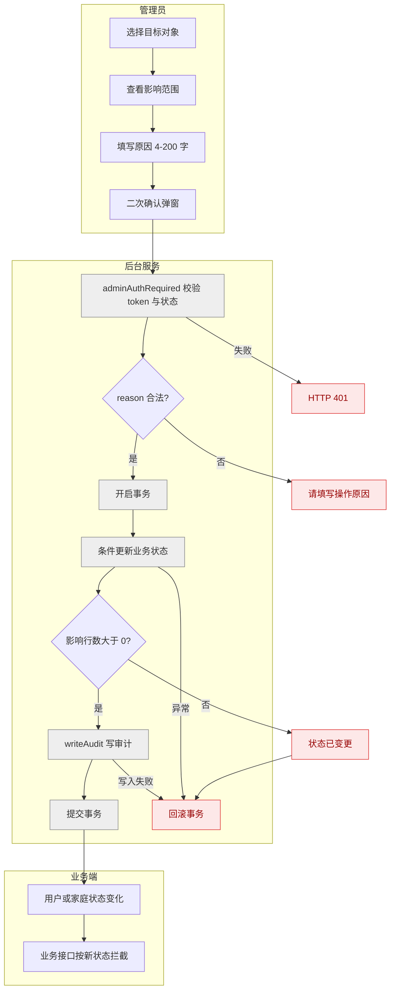

## 2. F1 管理员登录与会话

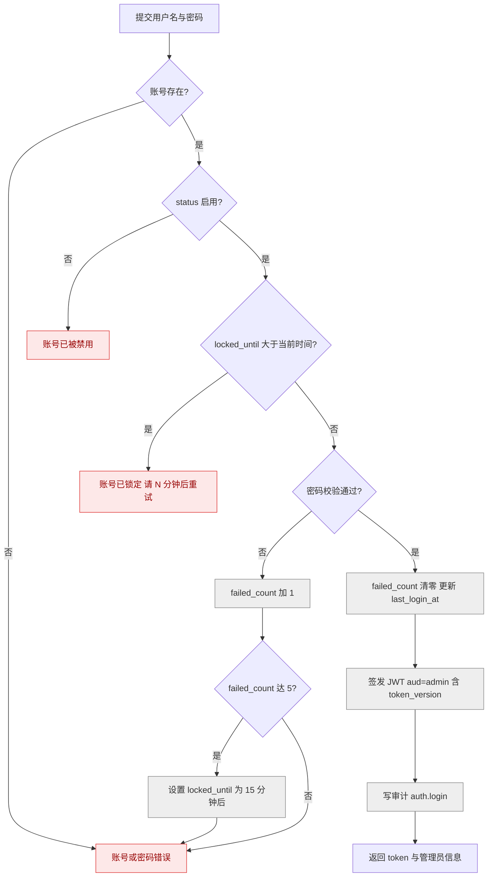

后续请求的校验链路：

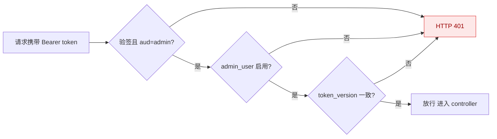

## 3. F2 家庭注销与恢复

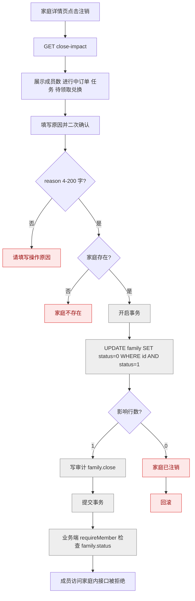

恢复流程与注销对称：条件为 `status = 0`，更新为 `status = 1`，家庭正常时返回 `家庭未注销`，审计动作为 `family.restore`。

## 4. F2.5 移除家庭成员（P2）

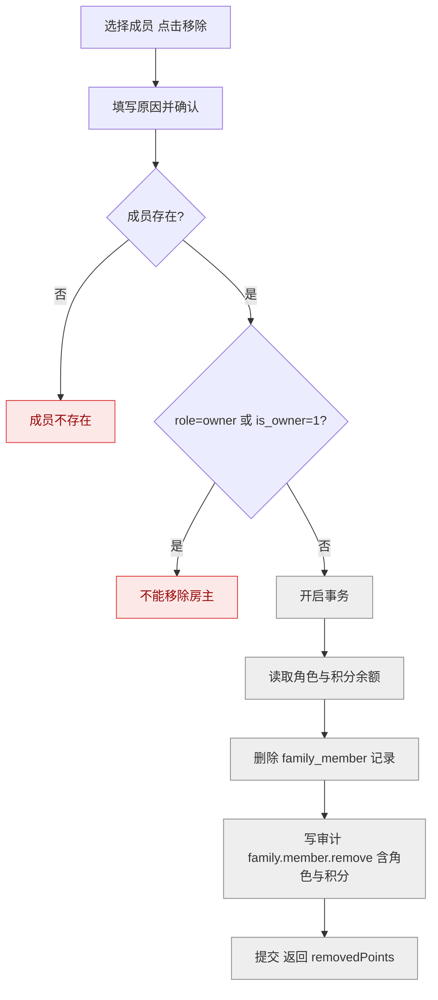

## 5. F3 菜品编辑、上下架与删除

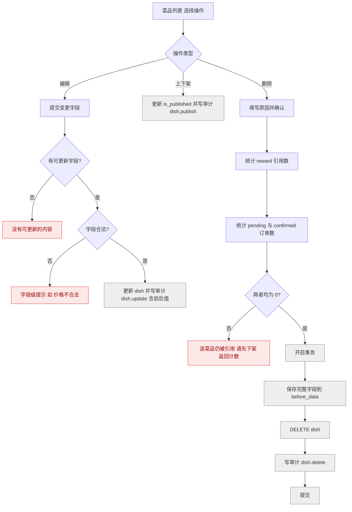

## 6. F3.6 批量上下架（P2）

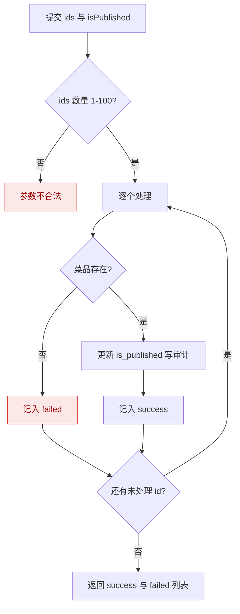

## 7. F4 禁用用户与重置密码

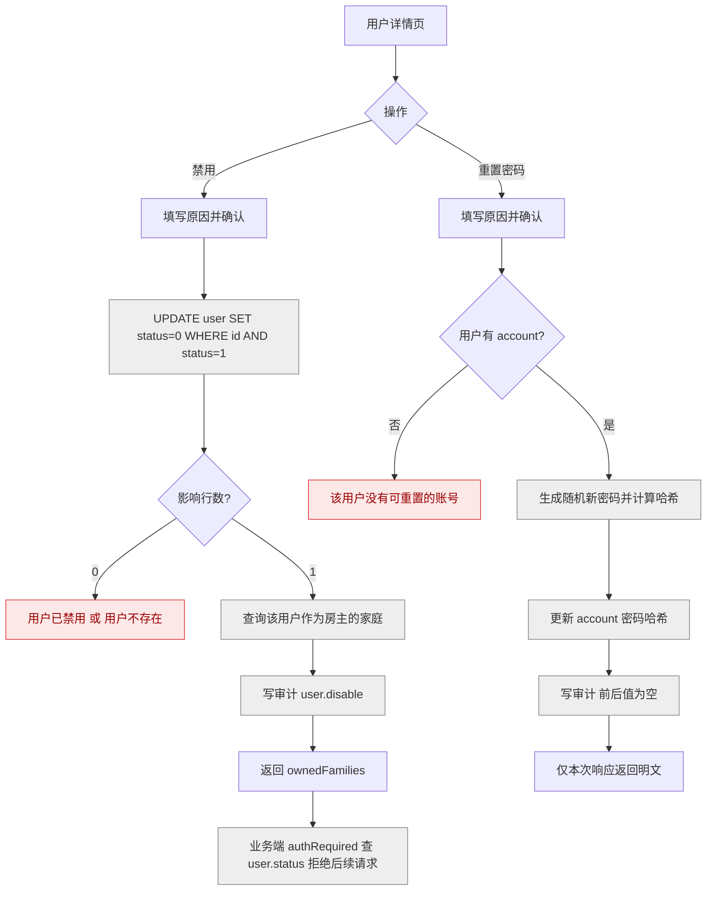

## 8. F5 强制取消订单

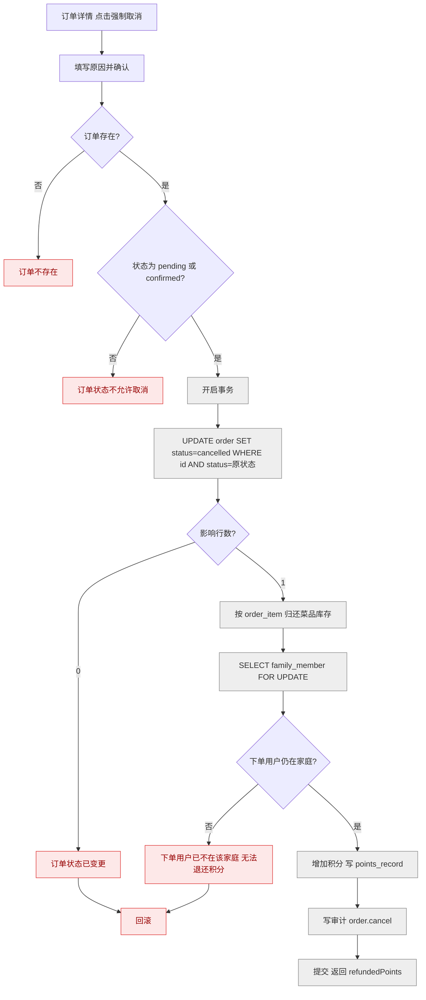

撤销兑换（F5.5）流程相同：条件为兑换状态是待领取，成功后退回积分并写审计 `reward_order.cancel`，状态不符时返回 `仅待领取状态的兑换可撤销`。

## 9. F6.2 手动调整积分（P2）

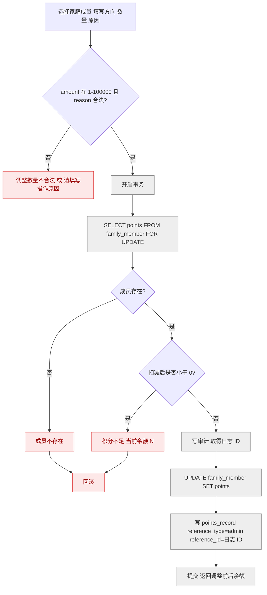

## 10. F7 AI 地域推荐重新生成与全量触发（P2）

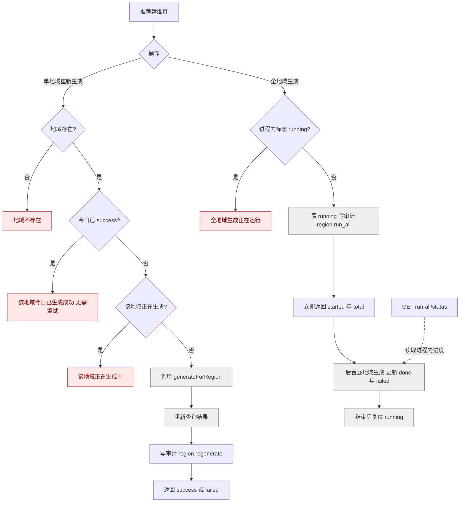

03:00 定时任务与手动触发共用同一个 `running` 标志，单进程部署下互斥有效，多实例部署需另行加锁 `[待确认]`（见 R1）。

## 11. F8.3 审计日志查询

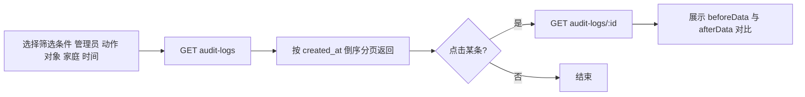

审计只读：无新增、修改、删除接口，写入只发生在各业务接口事务内。
