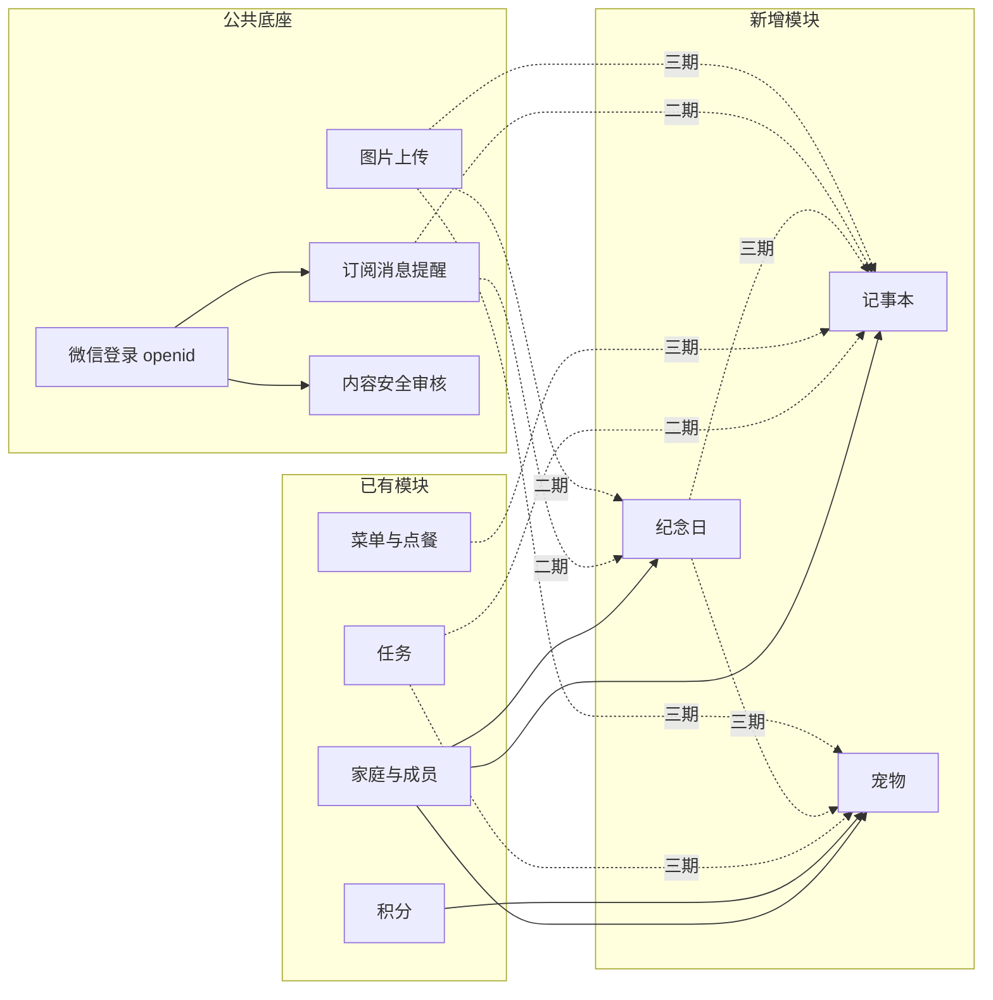

# 家庭手札三模块：总览与路线图

| 项 | 内容 |
| --- | --- |
| 文档类型 | 产品模块设计 - 总览 |
| 状态 | 草案 v0.1（待评审） |
| 日期 | 2026-11-23 |
| 覆盖模块 | 家庭纪念日、家庭记事本、家庭宠物 |
| 深度约定 | MVP 写完整规格，二期、三期只列功能清单与依赖 |
| 标注约定 | `[待确认-xxx]` 表示没有依据、需要你拍板；`[建议]` 表示我的发散建议，不属于需求原文 |

配套文档：

- `01-纪念日模块.md`
- `02-记事本模块.md`
- `03-宠物模块.md`

---

## 1. 背景与目标

家味小札当前已有：家庭与成员（owner / admin / member）、菜单与点餐、任务、积分、积分商城、AI 地域化三餐推荐（v1.1，仍在调试）。

新增三个模块，目标是让家庭**每天都有理由打开小程序**，而不只在点餐时使用：

| 模块 | 一句话定位 | 对应家庭场景 |
| --- | --- | --- |
| 纪念日 | 带日期的家庭记忆触发器 | 生日、结婚纪念日、孩子里程碑、倒数日 |
| 记事本 | 全家共享的轻量内容容器 | 采购清单、家人留言、便签 |
| 宠物 | 全家共养的虚拟吉祥物（真实宠物关联放三期） | 亲子日常互动、积分新去处 |

## 2. 模块关系

实线表示 MVP 就有的依赖，虚线表示后续期次才接入。

## 3. 版本路线（建议）

三个模块的 MVP **互不依赖**，也都**不依赖公共底座**，所以先后顺序取决于价值验证和风险，可以随意对调。

| 建议版本 | 内容 | 说明 |
| --- | --- | --- |
| v1.3 | 宠物 MVP | 最能验证"家庭是否愿意持续互动"，同时带"游戏"属性的审核风险，宜早暴露 |
| v1.4 | 记事本 MVP | 最通用，开发量最小 |
| v1.5 | 纪念日 MVP | 需要引入农历库，单独成版便于验证日期计算 |
| v1.6 | 公共底座 | 微信登录（openid）、订阅消息、图片上传、内容安全，解锁各模块二三期 |
| v1.7 起 | 各模块二期、三期 | 按底座就绪情况和使用数据排期 |

`[待确认-版本号与顺序]`：以上版本号和顺序是我的建议，不是已有约定。

**与 v1.1 / v1.2 的边界**：三个新模块不触碰 `daily_region_recommendation*` 相关表和 `region-recommendation` 接口，迁移脚本独立编号，文档里不出现"推荐"逻辑。

## 4. 公共底座与关键依赖

### 4.1 已核实的现状

| 项 | 现状 | 依据 |
| --- | --- | --- |
| 图片上传 | 没有。`server/package.json` 里无 multer / OSS / COS 依赖，现有图片字段只存 URL | 读取 package.json 与 schema |
| 积分结构 | 按家庭按成员存于 `family_member.points`；流水表 `points_record.type` 为 varchar，可新增类型 | `jiawei_db_schema.sql` |
| 路由与响应 | 路由挂在 `/api/{模块}`，`familyId` 走 query 或 body，响应 `{ code, message, data }`，权限用 `requireMember` / `requireAdmin` | `app.ts`、`taskController.ts`、`response.ts` |
| 登录方式 | 账号密码，没有 `code2session` / openid 流程 | 项目记忆记录（2026-11-19 评估），本次未重新核对代码 |
| 相关表 | 库内没有宠物、纪念日、记事本相关表 | schema 全表扫描 |

### 4.2 一个会影响二三期的问题：没有 openid

订阅消息推送需要用户的 openid。内容安全接口 `msgSecCheck` 据我了解新版同样要求传 openid。当前登录体系没有 openid，所以：

| 能力 | 依赖 openid | 影响 |
| --- | --- | --- |
| 订阅消息提醒（纪念日提前提醒、记事本提醒、宠物饿了） | 是 | 二期的"提醒"类功能全部被卡住 |
| 文本内容安全审核 | 据我了解是 `[待确认-核对微信官方文档]` | MVP 就有用户输入文本（宠物名、便签、纪念日标题），上线审核可能被要求 |

因此"微信登录接入"应列为公共底座的第一项，不是附属项。

`[待确认-MVP 上线前是否必须有文本安全审核]`：如果必须，v1.6 底座需要前移，或 MVP 先限制为"仅家庭内可见"并在审核说明里写明。

### 4.3 公共底座清单

| 序号 | 能力 | 前置 | 被谁依赖 | 建议版本 |
| --- | --- | --- | --- | --- |
| B1 | 微信登录（code2session，绑定 openid） | 无 | B2、B4 | v1.6 |
| B2 | 订阅消息提醒（授权、续订、发送、失败降级） | B1 | 纪念日二期、记事本三期、宠物三期 | v1.6 |
| B3 | 图片上传（存储选型、大小与格式限制、访问权限） | 无 | 纪念日二期、记事本三期、宠物三期 | v1.6 |
| B4 | 内容安全审核（文本、图片） | B1 | 全部含用户输入的功能 | v1.6，MVP 视上一条结论 |

订阅消息的约束：用户每次授权通常只能收到一条，需要在用户打开小程序时引导续订。"提前 7 天、3 天、1 天"这类多次提醒在这个机制下不一定能全部送达，`[待确认-提醒策略与降级方案]`（如小程序内红点、首页卡片作为兜底）。

## 5. 跨模块约定

### 5.1 权限

沿用现有三级角色，不新增角色：

| 角色 | 通用能力 |
| --- | --- |
| owner / admin | 管理本家庭的全部数据，包括他人创建的内容 |
| member | 创建内容、管理自己创建的内容，具体到各模块见模块文档 |

孩子在系统里就是 `member`。如果需要"儿童受限视图"（例如看不到某类笔记、不能删除），`[待确认-是否需要独立的儿童角色或受限标记]`，这会改动 `family_member` 表，不在 MVP 内。

### 5.2 接口与数据

- 路由前缀：`/api/anniversary`、`/api/note`、`/api/pet`，在 `server/src/app.ts` 中注册。
- 分页参数：`page`（从 1 起）、`pageSize`；返回 `{ list, total, page, pageSize }`。`[待确认-与现有列表接口分页结构一致]`
- 错误：沿用 `res.fail(message, code)`，其中 `code` 写入响应体；具体取值各模块文档里列出。
- 字段命名：数据库 snake_case，接口返回 camelCase。`[待确认-与现有接口返回风格保持一致]`
- 迁移脚本：放 `server/docs/migrations/`，沿用 `YYYYMMDDNN_名称.sql` 命名。每个模块一份迁移，改表时同步更新 `server/docs/DATABASE.md` 与 `server/docs/jiawei_db_schema.sql`，并提醒执行迁移（此前出现过未执行迁移导致 `Unknown column` 的问题）。
- 时区：日期类计算统一在服务端，按 `Asia/Shanghai`，不信任客户端时间。`[待确认-时区]`
- 软删除：纪念日、记事本使用 `deleted_at`，为二期回收站预留；宠物用状态字段。

### 5.3 积分流水新增类型

| type | 模块 | 方向 | 阶段 |
| --- | --- | --- | --- |
| `pet_feed` | 宠物 | 支出 | MVP |
| `pet_reward` | 宠物 | 收入 | 二期，需先设计防刷上限 |
| `note_item_reward` | 记事本 | 收入 | 三期，需每日上限 |

MVP 只新增 `pet_feed` 这一个类型，并且**宠物成长不产生积分**，避免出现"喂养获积分、积分再喂养"的循环。

### 5.4 编码风格

遵循项目约定：4 空格缩进、单引号、不加分号、camelCase、常量 UPPER_SNAKE_CASE。后端按 `routes → controllers → services` 分层；前端 uni-app + Vue 3 + TS。

## 6. 跨模块联动（按期次）

| 联动 | 说明 | 期次 | 依赖 |
| --- | --- | --- | --- |
| 纪念日 ↔ 记事本 | 纪念日详情下挂笔记，存放策划清单、祝福、往年回忆 | 纪念日三期 + 记事本三期 | 两边都有稳定的 id 与权限模型 |
| 纪念日 ↔ 宠物 | 宠物生日、领养日自动生成纪念日 | 宠物三期 | 纪念日 MVP |
| 记事本 ↔ 任务 | 清单条目一键转家庭任务 | 记事本二期 | 任务模块现有创建接口 |
| 记事本 ↔ 菜单 | 由点好的菜单生成采购清单 | 记事本三期 | 订单、菜品数据结构 |
| 宠物 ↔ 任务 | 完成任务给宠物养料；宠物心愿生成任务 | 宠物二期 | 任务模块；防刷设计 |
| 宠物 ↔ 记事本 | 宠物日记、真实宠物健康记录作为笔记形态 | 宠物三期 | 记事本三期 |

MVP 阶段三个模块彼此独立，不产生任何跨模块调用。

## 7. 全局待确认问题

| 编号 | 问题 | 影响范围 | 我的默认建议 |
| --- | --- | --- | --- |
| G1 | 版本号与 MVP 顺序 | 排期 | 宠物 v1.3 → 记事本 v1.4 → 纪念日 v1.5 → 底座 v1.6 |
| G2 | MVP 上线前是否必须有文本内容安全审核 | 底座是否前移 | 先核对微信官方要求再定 |
| G3 | 提醒策略与订阅消息不可靠时的降级 | 二期 | 首页卡片 + 红点兜底 |
| G4 | 是否需要儿童受限视图 | 权限、表结构 | 先不做，二期再评估 |
| G5 | 同一用户在多个家庭时，个人生日放用户级还是家庭级 | 纪念日表设计 | MVP 放家庭级，二期再提升 |
| G6 | 各模块入口放在哪个页面、tabBar 是否调整 | 前端 | 需要你确认；我没有核对现有 tabBar 结构 |
| G7 | 微信小程序类目：虚拟养成带"游戏"属性，是否需要额外类目或资质 | 宠物模块上线 | 需核对最新审核规则，我没有查证 |

## 8. 主要风险

| 风险 | 说明 | 缓解 |
| --- | --- | --- |
| 小程序审核 | 宠物养成带游戏属性；用户生成内容需安全审核 | MVP 严守：无充值、无抽奖、无现金兑换，积分只在家庭内流转；上线前核对类目 |
| 数值失衡 | 宠物成长速度、喂养成本是估算值 | 数值全部做成常量配置，上线后看数据再调 |
| 积分通胀 | 新增积分产出会破坏商城平衡 | MVP 只加"消耗"不加"产出" |
| 提醒不可达 | 订阅消息授权机制限制 | 底座阶段设计兜底 |
| 日期计算错误 | 农历闰月、2 月 29 日、农历 30 日等边界 | 纪念日文档中列出规则与测试用例，评审后固化 |

## 9. MVP 范围对照

| 模块 | MVP 包含 | MVP 明确不含 |
| --- | --- | --- |
| 纪念日 | 增删改查、公历与农历、倒计时与即将到来、全家可见 | 提醒、保密、祝福墙、图片、内置节日、每月重复 |
| 记事本 | 便签与清单、置顶、清单条目勾选、全家可见 | 标签、搜索、@ 与已读、可见范围、回收站、图片、提醒 |
| 宠物 | 领养、命名、喂食（耗积分）、摸摸、饱腹与心情、3 个成长阶段、毕业 | 任务联动、装扮、AI 说话、心愿、真实宠物、图片 |
