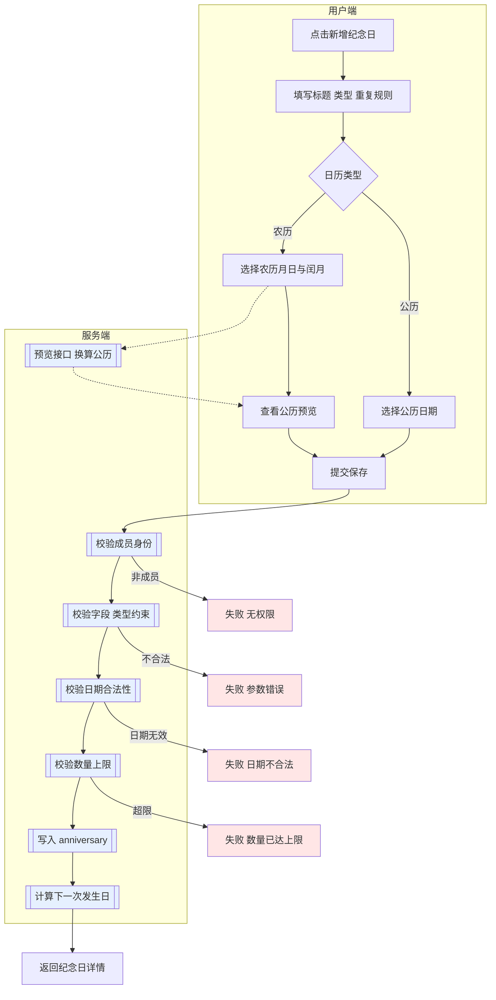
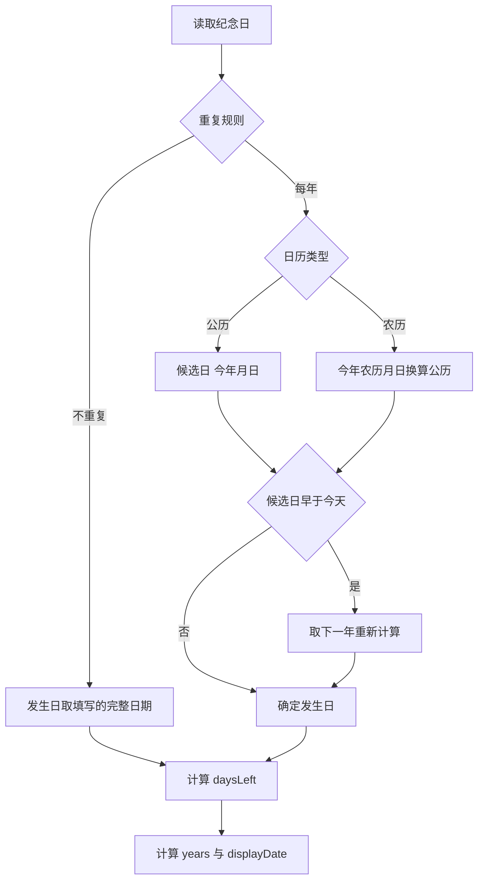
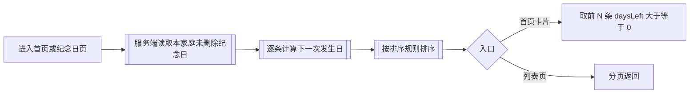
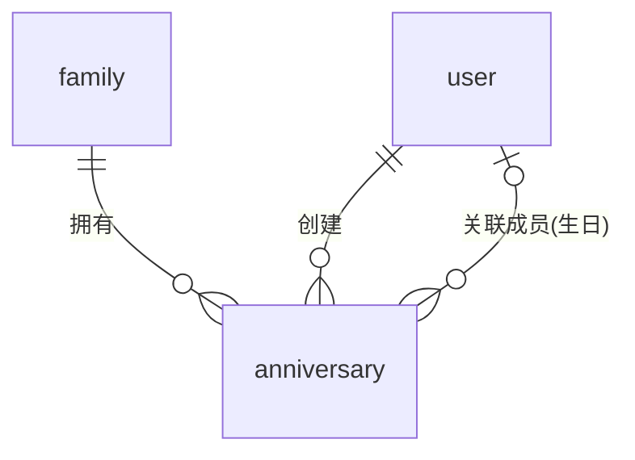

# 纪念日模块（MVP 完整规格）

| 项 | 内容 |
| --- | --- |
| 文档类型 | 产品模块设计 |
| 状态 | 草案 v0.1（待评审） |
| 日期 | 2026-11-23 |
| 建议版本 | v1.5 `[待确认-见总览 G1]` |
| 范围 | MVP 完整规格；二期、三期只列清单 |

---

## 1. 模块定位

纪念日是**带日期的家庭记忆触发器**：记录家里重要的日子，计算离下一次还有多久，让全家在首页一眼看到"快到了"。

核心价值：

1. 不漏掉重要的日子（尤其农历生日，国内老人家庭刚需）。
2. 让家人看到同一份日程，不再靠一个人记。
3. 为二三期的"惊喜策划""祝福墙""同日回顾"打好日期底座。

### MVP 范围

| 包含 | 不含（后续期次） |
| --- | --- |
| 纪念日增删改查 | 提前提醒（依赖订阅消息）— 二期 |
| 公历与农历 | 保密 / 指定成员可见 — 二期 |
| 按"下一次发生日"排序、倒计时 | 照片、祝福墙、往年记录 — 二期 |
| 即将到来的纪念日卡片 | 内置传统节日、每月重复 — 二期 |
| 全家可见 | 惊喜策划、AI 祝福语、周年分享卡 — 三期 |

## 2. 现状核实

- 库内没有任何生日、纪念日相关字段。`user` 表只有昵称、头像；`family_member` 只有 `role`、`admin_remark`、`points`。这是全新模块，不需要兼容旧结构。
- 服务端没有农历转换能力，需要引入农历库。

## 3. 角色矩阵

| 角色 | 职责 | 权限 | 关联功能 |
| --- | --- | --- | --- |
| owner / admin | 管理家庭全部纪念日 | 创建、查看、编辑、删除任意纪念日 | F1–F8 |
| member | 记录自己关心的日子 | 创建、查看全部；编辑、删除自己创建的 | F1–F8 |

`[待确认-成员创建权限]`：我假设"任何成员都能创建，只能改自己创建的"。另一种选择是只有 admin 能创建公共纪念日。需要你拍板。

## 4. 功能树

- **纪念日模块**
  - **F1 创建纪念日** [P1]
    - 描述：填写标题、类型、日期（公历或农历）、重复规则、可选备注与关联成员
    - 触发：纪念日列表页点"新增"
    - 主流程：选类型 → 填标题 → 选日历类型 → 选日期 → 选重复规则 → 保存
    - 分支：选农历时，页面实时显示对应的公历日期预览（F9）；类型为生日时可关联家庭成员
    - 异常：日期不合法、标题为空或超长、超出数量上限、非本家庭成员
    - 前置条件：已登录且是该家庭成员
    - 后置状态：新增一条纪念日，全家可见，出现在列表与（若临近）首页卡片
  - **F2 纪念日列表** [P1]
    - 描述：展示家庭全部纪念日，每条带下一次发生日、倒计时
    - 触发：进入纪念日页
    - 主流程：加载列表 → 即将到来的按剩余天数升序 → 已过去的单次纪念日排在后面
    - 分支：按类型筛选（F7）
    - 异常：无数据显示空状态引导新增
    - 后置状态：无变更
  - **F3 即将到来卡片** [P1]
    - 描述：首页或入口页展示最近 N 条（默认 3）即将到来的纪念日
    - 触发：进入首页
    - 主流程：请求 upcoming 接口 → 展示"距离 xxx 还有 N 天 / 就是今天"
    - 异常：接口失败时卡片隐藏，不阻塞首页
  - **F4 编辑纪念日** [P1]
    - 描述：修改除家庭归属外的全部字段
    - 异常：无权限、纪念日不存在或已删除
  - **F5 删除纪念日** [P1]
    - 描述：软删除，二次确认
    - 异常：无权限、已被删除
  - **F6 日期计算（系统能力）** [P1]
    - 描述：计算每条纪念日的下一次公历发生日、剩余天数、第 N 年
    - 规则：见第 5 节
  - **F7 按类型筛选** [P2]
  - **F8 生日关联成员** [P2]：选择家庭成员后，列表显示成员昵称与年龄
  - **F9 日期预览** [P2]：选农历时调用接口预览对应公历日期

## 5. 业务规则

### 5.1 类型与约束

| 类型 | 值 | 默认重复 | 是否必须带年份 | 说明 |
| --- | --- | --- | --- | --- |
| 生日 | `birthday` | 每年 | 否（带年份才显示年龄） | 可关联成员 |
| 纪念日 | `anniversary` | 每年 | 否（带年份才显示第 N 周年） | 结婚、恋爱等 |
| 里程碑 | `milestone` | 不重复 | 是 | 周岁、入学等，显示"已经 N 天" |
| 倒数日 | `countdown` | 不重复 | 是 | 未来某天，显示"还有 N 天" |
| 自定义 | `custom` | 可选 | 视重复规则 | 其他 |

`milestone`、`countdown` 只允许 `repeat_rule = none` 且必须带完整年月日。

### 5.2 下一次发生日计算

"今天"取服务端 `Asia/Shanghai` 当天日期。

| 情形 | 规则 |
| --- | --- |
| 公历 + 每年 | 候选日 = 今年 月-日；早于今天则取明年 |
| 公历 + 每年 + 2 月 29 日 | 非闰年按 2 月 28 日 `[待确认-也可取 3 月 1 日]` |
| 农历 + 每年 | 把今年对应农历年的 月-日 换算成公历；早于今天则取下一农历年 |
| 农历闰月生日 | 当年没有该闰月时，按同月非闰月处理 `[待确认]` |
| 农历 30 日 | 当年该月只有 29 天时，按 29 日处理 `[待确认]` |
| 不重复 | 发生日 = 填写的完整日期；`daysLeft` 为负数表示已过去 |
| 当天 | `daysLeft = 0`，`isToday = true` |

派生字段：

- `daysLeft`：`下一次发生日 - 今天`（天）。
- `years`：每年重复且带年份时 = 发生日所在年 - 起始年（农历按农历年差）；否则为空。
- `displayDate`：农历显示为"农历八月十五"这类文案，公历显示"8月15日"。

### 5.3 排序

1. `daysLeft >= 0` 的按 `daysLeft` 升序。
2. 其后是已过去的单次纪念日，按 `daysLeft` 降序（最近过去的在前）。

### 5.4 字段与数量限制 `[待确认-数值]`

| 项 | 限制 |
| --- | --- |
| 标题 | 1–32 字 |
| 备注 | ≤ 200 字 |
| 单个家庭纪念日总数 | ≤ 100 |
| 年份范围 | 1900–2100（农历库支持范围内） |

### 5.5 权限矩阵

| 操作 | owner / admin | member |
| --- | --- | --- |
| 查看 | 全部 | 全部 |
| 创建 | 是 | 是 `[待确认]` |
| 编辑、删除 | 全部 | 仅自己创建的 |

### 5.6 关联成员失效

生日关联的成员退出家庭后：纪念日保留，列表只显示标题，不再显示成员昵称与年龄。`[待确认]`

## 6. 逻辑流程图

### 6.1 创建纪念日（含农历预览与异常）



### 6.2 下一次发生日计算



### 6.3 即将到来卡片与列表



## 7. 数据实体

### 7.1 `anniversary`

| 字段 | 类型 | 必填 | 说明 |
| --- | --- | --- | --- |
| id | bigint unsigned | 是 | 主键 |
| family_id | bigint unsigned | 是 | 家庭 ID |
| creator_id | bigint unsigned | 是 | 创建人用户 ID |
| title | varchar(32) | 是 | 标题 |
| type | enum('birthday','anniversary','milestone','countdown','custom') | 是 | 类型 |
| calendar_type | enum('solar','lunar') | 是 | 默认 solar |
| event_year | smallint unsigned | 否 | 起始年份；里程碑、倒数日必填 |
| event_month | tinyint unsigned | 是 | 月 |
| event_day | tinyint unsigned | 是 | 日 |
| is_leap_month | tinyint(1) | 是 | 农历闰月标记，默认 0 |
| repeat_rule | enum('none','yearly') | 是 | 重复规则 |
| member_user_id | bigint unsigned | 否 | 关联成员（生日） |
| remark | varchar(200) | 否 | 备注 |
| created_at / updated_at | datetime | 是 | 时间戳 |
| deleted_at | datetime | 否 | 软删除 `[建议]`，二期回收与往年记录需要 |

索引：`idx_family_deleted (family_id, deleted_at)`、`idx_member (member_user_id)`。

下一次发生日、倒计时**不入库**，每次读取时计算，避免每天刷新数据。

### 7.2 关系



### 7.3 二三期预留（只列方向，不设计）

`anniversary_reminder`（提前几天提醒）、`anniversary_memory`（每年的照片、文字、祝福）、`anniversary_member`（多成员关联）。

## 8. API 接口规格

统一约定：需登录；`familyId` 走 query 或 body；成功 `{ code: 0, message, data }`；失败 `code` 非 0。字段 camelCase `[待确认-与现有接口一致]`。调用方均为前端小程序 / H5。

### 8.1 列表

- **URL**：`GET /api/anniversary`
- **参数**：`familyId`（必填）、`type`（可选）、`scope`（`all` / `upcoming` / `past`，默认 `all`）、`page`、`pageSize`
- **响应 data**：`{ list: [Anniversary], total, page, pageSize }`
- **错误**：400 缺参数、401 未登录、403 非成员

`Anniversary` 返回结构：

```json
{
    "id": 1,
    "title": "妈妈生日",
    "type": "birthday",
    "calendarType": "lunar",
    "eventYear": 1970,
    "eventMonth": 8,
    "eventDay": 15,
    "isLeapMonth": false,
    "repeatRule": "yearly",
    "memberUserId": 3,
    "memberName": "妈妈",
    "remark": "",
    "creatorId": 3,
    "nextDate": "2027-09-15",
    "daysLeft": 296,
    "isToday": false,
    "years": 57,
    "displayDate": "农历八月十五",
    "canEdit": true
}
```

### 8.2 即将到来

- **URL**：`GET /api/anniversary/upcoming`
- **参数**：`familyId`、`limit`（默认 3，最大 10）
- **响应 data**：`{ list: [Anniversary] }`，只含 `daysLeft >= 0`，升序

### 8.3 详情

- **URL**：`GET /api/anniversary/:id`
- **参数**：`familyId`
- **错误**：404 不存在或已删除

### 8.4 创建

- **URL**：`POST /api/anniversary`
- **Body**：`familyId`、`title`、`type`、`calendarType`、`eventYear?`、`eventMonth`、`eventDay`、`isLeapMonth?`、`repeatRule`、`memberUserId?`、`remark?`
- **响应**：新建的 `Anniversary`
- **错误**：400 参数或日期不合法、403 无权限、409 数量已达上限 `[待确认-错误码取值]`

### 8.5 更新

- **URL**：`PUT /api/anniversary/:id`
- **Body**：同创建（不含 `familyId` 变更）
- **错误**：403 非创建人且非管理员、404

### 8.6 删除

- **URL**：`DELETE /api/anniversary/:id?familyId=`
- **行为**：软删除
- **错误**：403、404

### 8.7 日期预览

- **URL**：`GET /api/anniversary/preview`
- **参数**：`calendarType`、`eventYear?`、`eventMonth`、`eventDay`、`isLeapMonth?`、`repeatRule`
- **响应 data**：`{ nextDate, daysLeft, displayDate }`
- **说明**：不落库，仅供创建页预览。无需 `familyId`，但仍要登录。

## 9. 验收条件（Given-When-Then）

### F1 创建

**场景 1：创建农历每年生日**
- Given：用户是家庭成员，选择类型"生日"、农历八月十五、每年重复
- When：提交保存
- Then：返回成功；列表出现该条；`nextDate` 为最近一个农历八月十五对应的公历日期；`daysLeft` 与服务端当天计算一致

**场景 2：里程碑缺少年份**
- Given：类型为 `milestone`，未填年份
- When：提交
- Then：失败，提示年份必填，不入库

**场景 3：不存在的日期**
- Given：公历 2 月 30 日
- When：提交
- Then：失败，提示日期不合法

**场景 4：超出数量上限**
- Given：本家庭已有 100 条
- When：再创建
- Then：失败，提示已达上限

**场景 5：非成员**
- Given：用户不属于该家庭
- When：调用创建
- Then：失败，无权限

### F2 / F6 列表与计算

**场景 1：排序**
- Given：有 3 条每年重复和 1 条已过去的单次纪念日
- When：打开列表
- Then：前 3 条按 `daysLeft` 升序，已过去的排在最后

**场景 2：当天**
- Given：某纪念日今天发生
- When：打开列表
- Then：`daysLeft = 0`、`isToday = true`，排第一

**场景 3：闰年 2 月 29 日**
- Given：公历 2 月 29 日每年重复，当前为非闰年
- When：读取
- Then：`nextDate` 按已确认规则（默认 2 月 28 日）计算

**场景 4：农历 30 日**
- Given：农历某月 30 日，当年该月仅 29 天
- When：读取
- Then：按 29 日计算，不报错

### F3 即将到来

**场景：卡片数量与过滤**
- Given：有 5 条纪念日，其中 1 条已过去
- When：请求 `upcoming?limit=3`
- Then：返回 3 条，均 `daysLeft >= 0`，升序

### F4 / F5 编辑与删除

**场景 1：成员编辑他人创建的**
- Given：member 要改 admin 创建的纪念日
- When：提交更新
- Then：失败，无权限

**场景 2：admin 删除**
- Given：admin 删除任意纪念日
- When：确认删除
- Then：列表不再出现；数据库 `deleted_at` 有值

## 10. 非功能需求（仅识别）

| 类别 | 要求 |
| --- | --- |
| 性能 | 单家庭 ≤ 100 条，列表读取时逐条计算，无需缓存；农历换算应为本地库调用，不依赖外部服务 |
| 安全 | 所有接口鉴权并校验家庭成员身份；标题、备注为用户输入，需转义输出、防注入；文本安全审核见总览 4.2 |
| 隐私 | 生日属于个人信息，MVP 仅家庭内可见；不收集身份证号 |
| 兼容 | 微信小程序 + H5 |
| 可维护 | 日期计算封装为独立 util，附完整单元测试（闰月、2 月 29 日、跨年） |

## 11. 二期、三期清单（仅列表，不设计）

| 期次 | 功能 | 依赖 |
| --- | --- | --- |
| 二期 | 提前 7 / 3 / 1 天及当天提醒 | 订阅消息（B2） |
| 二期 | 保密（仅自己可见 / 除当事人外可见） | 无 |
| 二期 | 详情页照片与文字回忆、往年时间轴 | 图片上传（B3） |
| 二期 | 内置传统节日、每月重复 | 节日数据 |
| 二期 | 祝福墙（集体送祝福，当事人当天解锁） | 无 |
| 二期 | 纪念日专属积分奖励 | 积分商城 |
| 三期 | 惊喜策划协作，打通任务与积分 | 任务模块 |
| 三期 | AI 祝福语与庆祝方案 | `aiService` |
| 三期 | 周年分享卡（可引用点餐订单数据） | 订单统计 |
| 三期 | 每年同日回顾 | 订单历史 |
| 三期 | 与记事本、宠物联动 | 对应模块 |

## 12. 待确认问题

| 编号 | 问题 | 默认建议 |
| --- | --- | --- |
| A1 | 成员是否都能创建纪念日 | 都能创建，只能改自己创建的 |
| A2 | 2 月 29 日、农历闰月、农历 30 日的非常规年处理 | 见 5.2 的默认规则 |
| A3 | 退出家庭的成员关联如何展示 | 只保留标题 |
| A4 | 农历库选型（如 `lunar-javascript`）及放在后端还是前端 | 后端计算，前端只展示 |
| A5 | 入口位置：首页卡片放在哪个页面 | 需要你确认，我没核对现有首页 |
| A6 | 标题、备注、数量上限的具体数值 | 见 5.4 |

## 13. 前端页面（草案）

| 页面 | 路径建议 | 说明 |
| --- | --- | --- |
| 纪念日列表 | `pages/anniversary/index` | 列表、类型筛选、新增入口 |
| 新增 / 编辑 | `pages/anniversary/edit` | 表单、农历切换、公历预览 |
| 详情 | `pages/anniversary/detail` | MVP 仅展示字段与操作 `[建议]` |
| 首页卡片组件 | `components/` 下新增 | 即将到来 N 条 |

## 14. 实施清单（落地时）

1. 新增迁移 `server/docs/migrations/YYYYMMDDNN_anniversary_v1.5.sql`，同步 `DATABASE.md`、`jiawei_db_schema.sql`。
2. 后端：`routes/anniversary.ts`、`controllers/anniversaryController.ts`、`services/anniversaryService.ts`、`utils/lunar.ts`；在 `app.ts` 注册 `/api/anniversary`。
3. 前端：上述页面、`pages.json` 注册、请求封装。
4. 测试：日期计算单测覆盖第 9 节全部边界。
