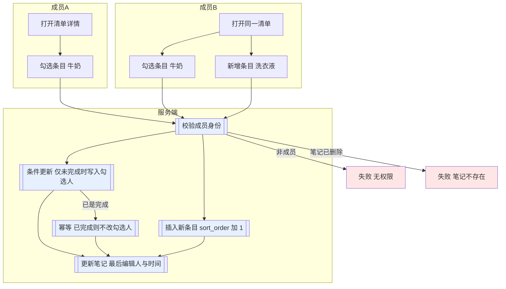
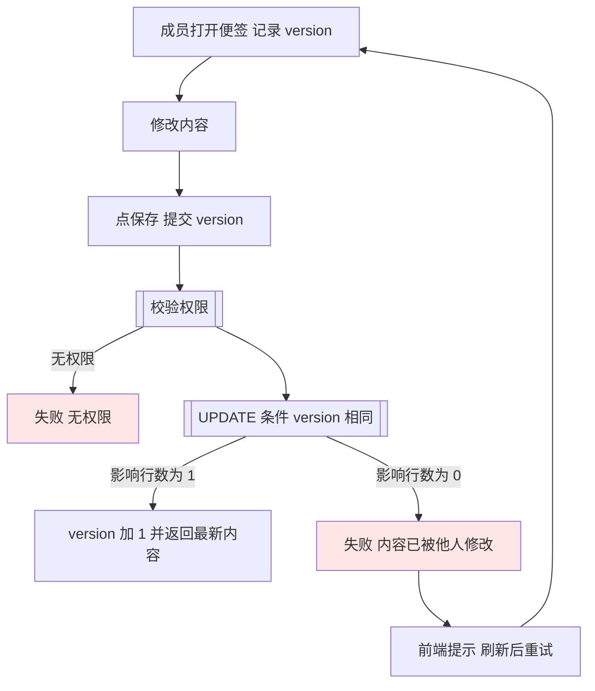
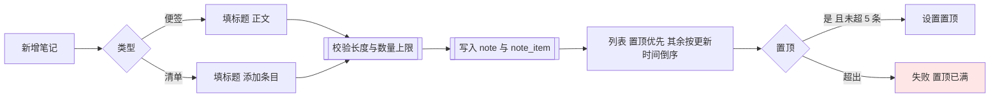
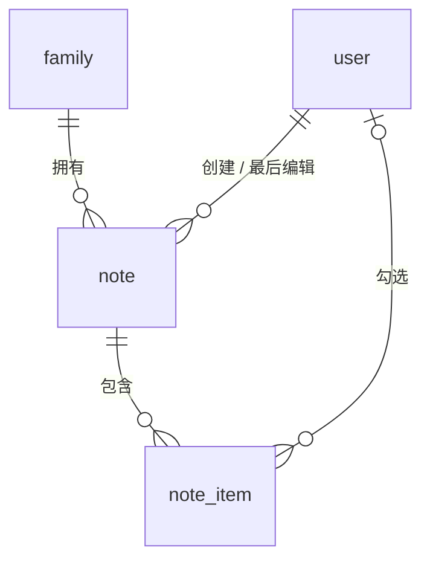

# 记事本模块（MVP 完整规格）

| 项 | 内容 |
| --- | --- |
| 文档类型 | 产品模块设计 |
| 状态 | 草案 v0.1（待评审） |
| 日期 | 2026-11-23 |
| 建议版本 | v1.4 `[待确认-见总览 G1]` |
| 范围 | MVP 完整规格；二期、三期只列清单 |

---

## 1. 模块定位

记事本是**全家共享的轻量内容容器**，不是个人备忘录（系统自带的备忘录已经够用）。它的价值在于：共享、协作、全家看得到。

MVP 只做两种形态：

| 形态 | 值 | 说明 | 典型场景 |
| --- | --- | --- | --- |
| 便签 | `memo` | 一段短文本，可置顶 | "钥匙在鞋柜上""周六家长会" |
| 清单 | `checklist` | 可勾选条目，全家共同勾 | 采购清单、出行行李清单 |

### MVP 范围

| 包含 | 不含（后续期次） |
| --- | --- |
| 便签、清单的增删改查 | 标签、搜索、归档、回收站 — 二期 |
| 置顶 | @ 成员与已读、可见范围 — 二期 |
| 清单条目独立增删改、勾选并记录是谁勾的 | 清单转任务、清除已完成、条目拖拽排序 — 二期 |
| 多人编辑冲突检测（便签） | 图片、手札（长文）、提醒、采购清单自动生成 — 三期 |
| 全家可见 | 积分奖励 — 三期 |

## 2. 现状核实

- 库内没有记事本相关表，只有订单、兑换等处的 `remark` 备注字段，与本模块无关。
- 没有图片上传能力，所以 MVP 不含图片。
- 现有 `task` 表有 `status` 与分配机制，二期"转任务"可复用。

## 3. 角色矩阵

| 角色 | 职责 | 权限 | 关联功能 |
| --- | --- | --- | --- |
| owner / admin | 管理家庭全部笔记 | 创建、查看、编辑、删除任意笔记；任意清单条目操作 | F1–F8 |
| member | 日常记录与协作 | 创建、查看全部；便签只能编辑、删除自己的；清单条目可由任何成员增加、勾选 | F1–F8 |

`[待确认-权限]`：我的依据是"便签偏个人表达，清单偏共同协作"。备选是所有笔记所有成员都能编辑，更简单，但容易被误删。

## 4. 功能树

- **记事本模块**
  - **F1 创建便签** [P1]
    - 描述：标题（可选）加正文，全家可见
    - 主流程：点新增 → 选"便签" → 填写 → 保存
    - 异常：标题与正文同时为空；超长；超出数量上限
    - 后置状态：新增 `note`，`type = memo`
  - **F2 创建清单** [P1]
    - 描述：标题加若干条目（可创建时一并提交，也可之后逐条添加）
    - 主流程：点新增 → 选"清单" → 填标题 → 添加条目 → 保存
    - 异常：标题为空；条目超过 100；单条内容为空或超长
  - **F3 笔记列表** [P1]
    - 描述：置顶在前，其余按最近更新时间倒序；清单显示"已完成/总数"
    - 分支：按类型筛选（F8）
    - 异常：空状态引导新建
  - **F4 笔记详情与编辑** [P1]
    - 描述：便签编辑标题、正文；清单展示条目并可编辑标题
    - 主流程：打开详情 → 修改 → 保存（带 `version`）
    - 异常：`version` 不一致提示"内容已被他人修改，请刷新"；无权限；已被删除
    - 后置状态：`version + 1`，记录最后编辑人
  - **F5 清单条目操作** [P1，跨角色]
    - 描述：新增、修改内容、勾选 / 取消勾选、删除条目；每个操作独立提交，不整篇覆盖
    - 主流程：在详情页点勾选 → 立即提交该条目状态 → 更新进度
    - 规则：勾选使用"显式设置为已完成 / 未完成"，不是"切换"，避免两人同时点击互相抵消
    - 后置状态：记录勾选人和时间；笔记最后编辑人和更新时间更新
  - **F6 置顶 / 取消置顶** [P1]
    - 描述：置顶笔记排在列表最前，每个家庭最多 5 条 `[待确认]`
  - **F7 删除笔记** [P1]
    - 描述：软删除，二次确认
    - 异常：无权限、已被删除
  - **F8 按类型筛选** [P2]

## 5. 业务规则

### 5.1 字段与数量限制 `[待确认-数值]`

| 项 | 限制 |
| --- | --- |
| 标题 | ≤ 64 字；便签可空，清单必填 |
| 便签正文 | ≤ 5000 字 |
| 清单条目 | 每条 1–255 字；单个清单 ≤ 100 条 |
| 家庭笔记总数 | ≤ 200 |
| 置顶数量 | ≤ 5 |

便签要求标题与正文至少有一个非空。

### 5.2 权限矩阵

| 操作 | owner / admin | member |
| --- | --- | --- |
| 查看 | 全部 | 全部 |
| 创建 | 是 | 是 |
| 编辑便签 / 清单标题 | 全部 | 仅自己创建的 |
| 删除笔记 | 全部 | 仅自己创建的 |
| 置顶 | 全部 | 仅自己创建的 `[待确认]` |
| 清单条目新增、修改、勾选、删除 | 是 | 是（全家共享） |

### 5.3 并发与冲突

| 场景 | 处理 |
| --- | --- |
| 两人同时编辑便签 | 乐观锁：更新时带 `version`，服务端 `WHERE id = ? AND version = ?`，影响行数为 0 则返回冲突，前端提示刷新；不做实时协同 |
| 两人同时勾选同一条目 | 显式设置状态，结果幂等；只有从未完成变已完成时才写入勾选人 |
| 两人同时新增条目 | 各自独立插入，互不影响；`sort_order` 取当前最大值加 1 |
| 编辑时对方已删除笔记 | 返回"笔记不存在"，前端返回列表 |

### 5.4 展示约定 `[建议]`

- 清单中已完成条目在前端沉底并置灰，数据层不改顺序。
- 列表项摘要：便签取正文前 60 字；清单显示"已完成 3 / 共 8"。
- 详情页底部显示"最后由 xx 编辑于 时间"。

## 6. 逻辑流程图

### 6.1 清单协作（多人勾选与异常）



### 6.2 便签编辑与冲突



### 6.3 创建、置顶与列表



## 7. 数据实体

### 7.1 `note`

| 字段 | 类型 | 必填 | 说明 |
| --- | --- | --- | --- |
| id | bigint unsigned | 是 | 主键 |
| family_id | bigint unsigned | 是 | 家庭 ID |
| type | enum('memo','checklist') | 是 | 形态；三期加手札时再扩展枚举 |
| title | varchar(64) | 是 | 标题，便签可为空字符串 |
| content | text | 否 | 便签正文；清单为空 |
| is_pinned | tinyint(1) | 是 | 默认 0 |
| pinned_at | datetime | 否 | 置顶时间，用于置顶之间排序 |
| creator_id | bigint unsigned | 是 | 创建人 |
| last_editor_id | bigint unsigned | 是 | 最后编辑人 |
| version | int unsigned | 是 | 乐观锁，默认 1 |
| created_at / updated_at | datetime | 是 | 时间戳 |
| deleted_at | datetime | 否 | 软删除 `[建议]` |

索引：`idx_family_list (family_id, deleted_at, is_pinned, updated_at)`、`idx_creator (creator_id)`。

### 7.2 `note_item`

| 字段 | 类型 | 必填 | 说明 |
| --- | --- | --- | --- |
| id | bigint unsigned | 是 | 主键 |
| note_id | bigint unsigned | 是 | 所属笔记 |
| content | varchar(255) | 是 | 条目内容 |
| is_done | tinyint(1) | 是 | 默认 0 |
| done_by | bigint unsigned | 否 | 勾选人 |
| done_at | datetime | 否 | 勾选时间 |
| sort_order | int | 是 | 排序 |
| created_by | bigint unsigned | 是 | 添加人 |
| created_at / updated_at | datetime | 是 | 时间戳 |

索引：`idx_note_sort (note_id, sort_order)`。条目随笔记软删除，不单独软删，条目删除为物理删除。

### 7.3 关系



### 7.4 二三期预留（只列方向）

`note_tag` / `note_tag_rel`（标签）、`note_mention`（@ 与已读）、`note_attachment`（图片）。

## 8. API 接口规格

统一约定同纪念日文档：需登录、`familyId` 走 query 或 body、响应 `{ code, message, data }`、字段 camelCase `[待确认]`。调用方均为前端。

### 8.1 笔记列表

- **URL**：`GET /api/note`
- **参数**：`familyId`、`type?`、`page`、`pageSize`
- **响应 data**：`{ list, total, page, pageSize }`

```json
{
    "id": 12,
    "type": "checklist",
    "title": "本周采购",
    "contentPreview": "",
    "isPinned": true,
    "itemTotal": 8,
    "itemDone": 3,
    "creatorId": 2,
    "creatorName": "妈妈",
    "lastEditorName": "爸爸",
    "updatedAt": "2026-11-23 10:30:00",
    "version": 5,
    "canEdit": true
}
```

### 8.2 笔记详情

- **URL**：`GET /api/note/:id`
- **参数**：`familyId`
- **响应**：笔记字段，另含 `content` 与 `items`（按 `sortOrder` 升序，含 `isDone`、`doneByName`、`doneAt`）
- **错误**：404

### 8.3 创建

- **URL**：`POST /api/note`
- **Body**：`familyId`、`type`、`title`、`content?`（便签）、`items?: string[]`（清单，≤ 100）
- **响应**：新建笔记详情
- **错误**：400 校验失败、409 笔记总数已达上限 `[待确认-错误码]`

### 8.4 更新便签 / 清单标题

- **URL**：`PUT /api/note/:id`
- **Body**：`familyId`、`title`、`content?`、`version`
- **错误**：403、404、409 版本冲突（提示"内容已被他人修改"）

### 8.5 删除

- **URL**：`DELETE /api/note/:id?familyId=`
- **行为**：软删除
- **错误**：403、404

### 8.6 置顶

- **URL**：`PATCH /api/note/:id/pin`
- **Body**：`familyId`、`pinned`（boolean）
- **错误**：409 置顶已满

### 8.7 条目新增

- **URL**：`POST /api/note/:id/item`
- **Body**：`familyId`、`content`
- **错误**：400、404、409 条目已达 100 条

### 8.8 条目修改 / 勾选

- **URL**：`PATCH /api/note/:id/item/:itemId`
- **Body**：`familyId`，`content?`、`isDone?`（至少一个；`isDone` 为显式布尔值）
- **幂等**：`isDone=true` 对已完成条目不改勾选人与时间

### 8.9 条目删除

- **URL**：`DELETE /api/note/:id/item/:itemId?familyId=`

## 9. 验收条件（Given-When-Then）

### F1 / F2 创建

**场景 1：创建清单带条目**
- Given：成员填写标题"本周采购"，3 个条目
- When：保存
- Then：列表出现清单，显示"已完成 0 / 共 3"；详情中条目顺序与提交一致

**场景 2：便签空内容**
- Given：标题与正文都为空
- When：保存
- Then：失败，提示至少填写一项

**场景 3：条目超限**
- Given：清单已有 100 条
- When：再添加
- Then：失败，提示已达上限

### F4 编辑与冲突

**场景 1：版本冲突**
- Given：A、B 同时打开便签，`version = 3`；A 先保存成功
- When：B 带 `version = 3` 保存
- Then：失败并提示内容已被他人修改；B 的内容不覆盖 A

**场景 2：成员改他人便签**
- Given：member 要编辑 admin 的便签
- When：保存
- Then：失败，无权限

### F5 条目操作

**场景 1：协作勾选**
- Given：成员 A 勾选"牛奶"，进度 1/3
- When：成员 B 同时勾选"鸡蛋"
- Then：两个条目都已完成，进度 2/3，勾选人分别为 A、B

**场景 2：重复勾选幂等**
- Given："牛奶"已由 A 勾选
- When：B 再提交 `isDone = true`
- Then：成功，勾选人仍为 A

**场景 3：成员增加他人清单的条目**
- Given：member 面对 admin 创建的清单
- When：新增条目
- Then：成功

### F6 / F7 置顶与删除

**场景 1：置顶已满**
- Given：已有 5 条置顶
- When：再置顶第 6 条
- Then：失败，提示置顶已满

**场景 2：删除后列表消失**
- Given：创建人删除笔记
- When：他人刷新列表
- Then：不再出现；数据库 `deleted_at` 有值，条目数据仍保留

## 10. 非功能需求（仅识别）

| 类别 | 要求 |
| --- | --- |
| 性能 | 列表聚合 `itemTotal / itemDone` 用单次关联统计，避免 N+1 |
| 安全 | 所有接口校验家庭成员身份；输出转义防 XSS；文本安全审核见总览 4.2 |
| 隐私 | MVP 全家可见，不要在笔记里存储证件号、银行卡号，需要在输入页给出提示 `[建议]` |
| 并发 | 乐观锁（便签）、条件更新（条目），不使用长事务 |
| 兼容 | 微信小程序 + H5 |

## 11. 二期、三期清单（仅列表，不设计）

| 期次 | 功能 | 依赖 |
| --- | --- | --- |
| 二期 | 标签与分类、搜索 | 无 |
| 二期 | 回收站与恢复、归档 | `deleted_at` 已预留 |
| 二期 | @ 成员与已读状态 | 无 |
| 二期 | 可见范围：全家 / 仅自己 / 指定成员 | 权限模型扩展 |
| 二期 | 清单条目一键转家庭任务 | 任务模块创建接口 |
| 二期 | 清除已完成条目、条目拖拽排序 | 无 |
| 二期 | 首页贴便签（置顶便签显示在首页） | 首页入口 |
| 三期 | 图片附件、育儿手札（长文加图片） | 图片上传（B3）、内容安全（B4） |
| 三期 | 提醒（笔记设提醒时间） | 订阅消息（B2） |
| 三期 | 由本周菜单自动生成采购清单 | 订单与菜品数据 |
| 三期 | 积分奖励（完成清单、写手札，需每日上限） | 积分防刷设计 |
| 三期 | 与纪念日联动、AI 口述转清单 | 对应模块 |

## 12. 待确认问题

| 编号 | 问题 | 默认建议 |
| --- | --- | --- |
| N1 | 便签的编辑、删除、置顶是否仅限创建人和管理员 | 是 |
| N2 | 清单条目是否允许任何成员增删改 | 是 |
| N3 | 孩子账号是否需要限制（如不能删除他人笔记）| 沿用 member 规则，二期评估 |
| N4 | 数量与长度上限的具体数值 | 见 5.1 |
| N5 | 敏感信息（Wi-Fi、过敏史）是否需要"仅管理员可见" | 放二期可见范围里解决 |
| N6 | 入口位置（独立页面、tabBar 或从首页进入）| 需要你确认，我没核对现有导航 |

## 13. 前端页面（草案）

| 页面 | 路径建议 | 说明 |
| --- | --- | --- |
| 笔记列表 | `pages/note/index` | 列表、置顶、类型筛选、新增入口 |
| 新增 / 编辑 | `pages/note/edit` | 便签与清单创建、标题与正文编辑 |
| 详情 | `pages/note/detail` | 清单勾选与条目管理、便签只读视图 |

## 14. 实施清单（落地时）

1. 新增迁移 `server/docs/migrations/YYYYMMDDNN_note_v1.4.sql`，同步 `DATABASE.md`、`jiawei_db_schema.sql`。
2. 后端：`routes/note.ts`、`controllers/noteController.ts`、`services/noteService.ts`；在 `app.ts` 注册 `/api/note`。
3. 前端：上述页面、`pages.json` 注册。
4. 测试：版本冲突、并发勾选幂等、权限矩阵、数量上限。
