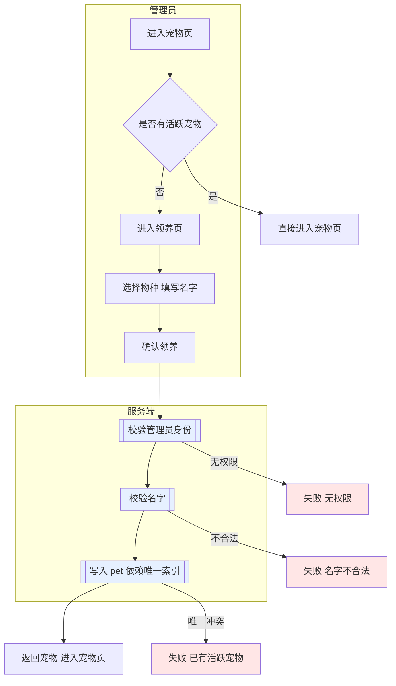
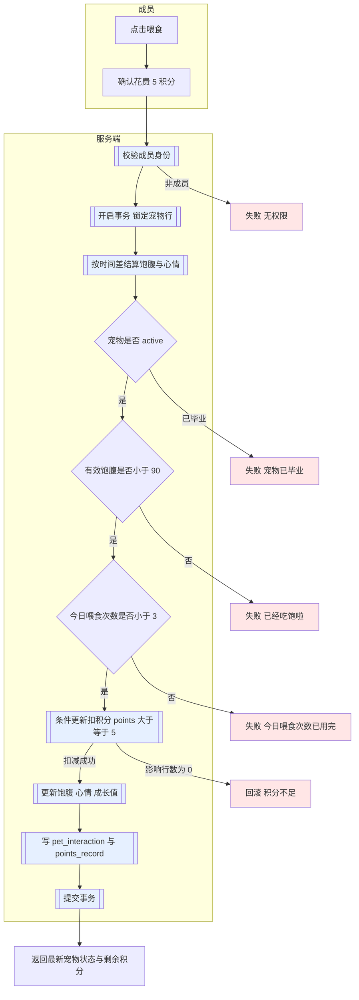
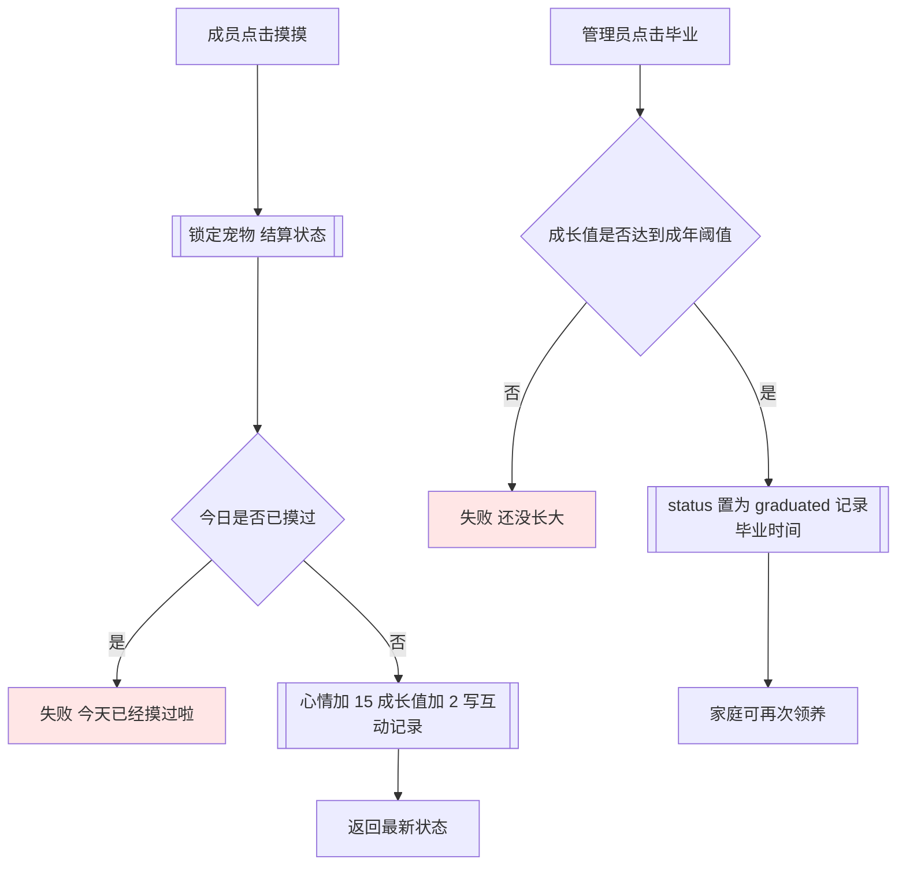
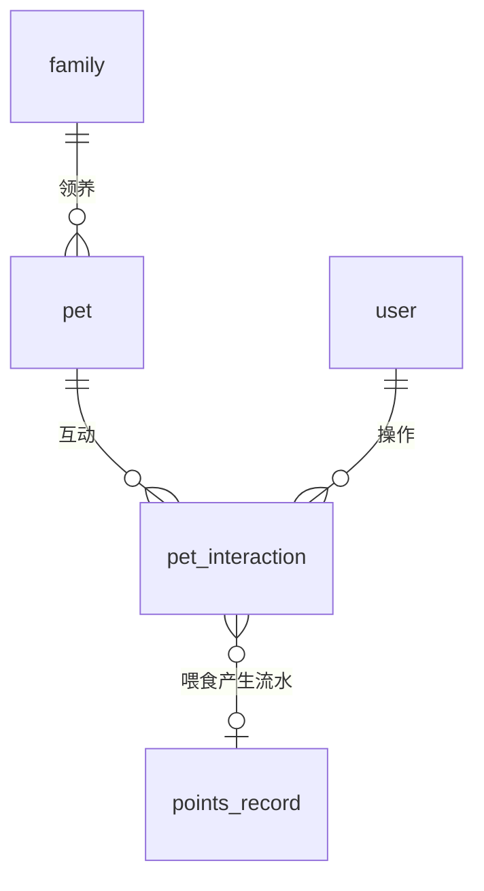

# 宠物模块（MVP 完整规格）

| 项 | 内容 |
| --- | --- |
| 文档类型 | 产品模块设计 |
| 状态 | 草案 v0.1（待评审） |
| 日期 | 2026-11-23 |
| 建议版本 | v1.3 `[待确认-见总览 G1]` |
| 范围 | MVP（仅虚拟宠物）完整规格；二期、三期只列清单 |

---

## 1. 模块定位

宠物是**一只属于整个家庭、全家共同照顾的虚拟吉祥物**，让孩子和大人每天有一个轻松的互动理由，并给积分增加一个"消耗"去处。

你提出的两条线：

| 线 | 说明 | 期次 |
| --- | --- | --- |
| 虚拟宠物（没有真实宠物的家庭） | 领养、喂养、互动、成长 | **MVP** |
| 真实宠物关联（家里有猫狗） | 档案、健康管理、日常打卡、虚拟分身 | 三期 |

MVP 只做虚拟宠物。真实宠物依赖图片上传和提醒（都属于公共底座，见总览 4.3），放到三期，同时避免 MVP 的表结构被"真实 / 虚拟"两种形态拖复杂。

### 设计原则

1. **共养**：一个家庭同时只有一只活跃的虚拟宠物。
2. **不惩罚**：状态低只会"蔫了"，不会"死亡"、不会"离家出走"，对低龄孩子友好。
3. **只消耗不产出**：MVP 里宠物成长**不产生积分**，避免积分循环。
4. **读时结算**：饱腹、心情随时间下降，用"读取时按时间差计算"，不新增定时任务。

### MVP 范围

| 包含 | 不含（后续期次） |
| --- | --- |
| 领养（选物种、起名） | 任务联动、宠物心愿 — 二期 |
| 喂食（耗积分）、摸摸（免费） | 装扮、家具、房间场景 — 二期 |
| 饱腹、心情、成长值 | AI 宠物说话 — 二期 |
| 3 个成长阶段 | 轮值饲养员、每日全家互动奖励 — 二期 |
| 毕业与历史宠物 | 真实宠物档案、健康提醒、虚拟分身 — 三期 |
| 每日互动次数限制 | 宠物日记、与纪念日 / 记事本联动 — 三期 |

## 2. 现状核实

- 库内没有宠物相关表。
- 积分存在 `family_member.points`（按家庭按成员），流水在 `points_record`，`type` 为 varchar，新增 `pet_feed` 不需要改表结构；`points_balance` 是无符号整型，扣减不能出现负数。
- 项目里没有图片上传，宠物形象只能用内置素材。
- 我在 `taskService.ts` 里确认了事务写法，但**没有看到积分扣减使用行锁**。因此本文喂食扣积分采用"条件更新"（`points >= 价格` 才扣），不依赖行锁，见 5.5。

## 3. 角色矩阵

| 角色 | 职责 | 权限 | 关联功能 |
| --- | --- | --- | --- |
| owner / admin | 管理家庭宠物 | 领养、改名、毕业；也能喂食和摸摸 | F1、F5–F7 及互动功能 |
| member（含孩子） | 日常照顾 | 查看宠物、喂食、摸摸、查看互动记录 | F2–F4 |

`[待确认-领养权限]`：我假设只有 owner / admin 能领养和毕业，防止孩子误操作。备选是任何成员都能领养。

## 4. 功能树

- **宠物模块**
  - **F1 领养虚拟宠物** [P1]
    - 描述：选择物种、取名，领养成功后成为家庭当前宠物
    - 触发：家庭无活跃宠物时，入口显示"去领养"
    - 主流程：进入领养页 → 浏览物种 → 选择 → 起名 → 确认
    - 异常：已有活跃宠物；名字为空、超长；非 owner / admin
    - 前置条件：家庭没有 `status = active` 的宠物
    - 后置状态：新增 `pet`（饱腹、心情初始为 60，成长值 0，阶段 1）
  - **F2 查看宠物** [P1]
    - 描述：展示宠物形象、名字、阶段、饱腹、心情、成长进度、今日互动情况
    - 主流程：打开宠物页 → 服务端先按时间差结算 → 返回最新状态
    - 异常：家庭无宠物时显示领养入口
  - **F3 喂食** [P1，跨角色]
    - 描述：消耗操作者个人积分购买宠物粮，提升饱腹、心情与成长值
    - 主流程：点"喂食" → 确认花费 → 扣积分 → 状态提升 → 记录互动
    - 规则：见第 5 节
    - 异常：积分不足；已吃饱；今日喂食次数用完；宠物已毕业
  - **F4 摸摸** [P1]
    - 描述：免费互动，提升心情与少量成长值，每位成员每天一次
    - 异常：今日已摸；宠物已毕业
  - **F5 修改宠物名字** [P2]：仅 owner / admin
  - **F6 毕业** [P1]
    - 描述：宠物到最高阶段后，由管理员让它"毕业"，释放名额，之后可领养新宠物
    - 前置条件：成长值达到成年阈值 `[待确认]`
    - 后置状态：`status = graduated`，进入历史列表
  - **F7 历史宠物列表** [P2]：查看已毕业的宠物及陪伴天数
  - **F8 互动记录** [P2]：查看最近的喂食、摸摸记录，显示是谁做的

## 5. 业务规则

数值全部为**初始估算**，要做成后端常量配置，上线后看数据调整。`[待确认-全部数值]`

### 5.1 物种与形象

MVP 提供 `cat`、`dog`、`rabbit`、`dinosaur` 四种 `[待确认-物种数量]`，每种 3 个成长阶段的内置素材。物种以常量表存于代码，不建表。

### 5.2 属性

| 属性 | 范围 | 初始值 | 说明 |
| --- | --- | --- | --- |
| 饱腹 satiety | 20–100 | 60 | 随时间下降，下限 20，不会为 0 |
| 心情 mood | 20–100 | 60 | 随时间下降，下限 20 |
| 成长值 growth | 0 起累加 | 0 | 只增不减 |

状态文案：

| 数值 | 饱腹文案 | 心情文案 |
| --- | --- | --- |
| ≥ 70 | 吃饱啦 | 很开心 |
| 40–69 | 有点饿 | 还不错 |
| < 40 | 饿扁了 | 有点蔫 |

### 5.3 随时间衰减（读时结算）

- 记录上次结算时间 `settled_at`。
- 有效饱腹 = `max(20, 存储饱腹 - floor(经过分钟数 × 3 / 60))`，即每小时降 3。
- 有效心情 = `max(20, 存储心情 - floor(经过分钟数 × 2 / 60))`，即每小时降 2。
- 每次读取与每次互动前先结算：把有效值写回，`settled_at` 置为当前时间。
- 因为下限是 20，长时间不玩也只会降到"饿扁了 / 有点蔫"，不会有惩罚后果。

### 5.4 互动效果与限制

| 互动 | 花费 | 饱腹 | 心情 | 成长值 | 限制 |
| --- | --- | --- | --- | --- | --- |
| 喂食 | 5 积分（操作者个人） | +25（上限 100） | +5 | +10 | 每人每天最多 3 次；有效饱腹 ≥ 90 时不能喂 |
| 摸摸 | 免费 | 0 | +15（上限 100） | +2 | 每人每天 1 次 |

单人单日成长值上限 = 3 × 10 + 2 = 32。

"每天"按服务端 `Asia/Shanghai` 日期计算，互动记录里存 `interact_date`。

### 5.5 扣积分与并发

- 对宠物行加锁（`SELECT ... FOR UPDATE`）后再计数当日次数、结算状态，这样同一只宠物的互动被串行化，次数限制不会被并发绕过。
- 扣积分用条件更新：`UPDATE family_member SET points = points - ? WHERE family_id = ? AND user_id = ? AND points >= ?`，`affectedRows = 0` 视为积分不足，回滚。
- 同一事务内写 `points_record`：`type = 'pet_feed'`、`reference_type = 'pet'`、`reference_id = 宠物 ID`、说明"喂养 {宠物名}"，`points_balance` 取扣减后的余额。

### 5.6 成长阶段 `[待确认-阈值]`

| 阶段 | 值 | 成长值区间 | 说明 |
| --- | --- | --- | --- |
| 幼年 | 1 | 0–99 | 领养后 |
| 少年 | 2 | 100–299 | |
| 成年 | 3 | ≥ 300 | 可毕业 |

阶段由成长值**读时推导**，不单独存储，避免不一致。

按本表，一个 3 人家庭几天即可到成年，节奏偏快，需要评审时调整。

### 5.7 唯一性

一个家庭同一时间只能有一只 `active` 宠物。用 MySQL 8 的生成列加唯一索引保证：

```sql
active_family_id BIGINT UNSIGNED
    GENERATED ALWAYS AS (IF(status = 'active', family_id, NULL)) STORED,
UNIQUE KEY uk_active_family (active_family_id)
```

重复领养并发时，第二个请求会因唯一索引冲突而失败，接口返回"已有活跃宠物"。

### 5.8 名字

1–8 个字，去除首尾空格，不允许全空白 `[待确认]`；文本安全审核见总览 4.2。

### 5.9 状态机

| 状态 | 说明 | 可达状态 | 触发 |
| --- | --- | --- | --- |
| `active` | 当前宠物 | `graduated` | 管理员毕业，且成长值达标 |
| `graduated` | 已毕业，只读 | 无 | — |

## 6. 逻辑流程图

### 6.1 领养



### 6.2 喂食（含积分与次数限制）



### 6.3 摸摸与毕业



## 7. 数据实体

### 7.1 `pet`

| 字段 | 类型 | 必填 | 说明 |
| --- | --- | --- | --- |
| id | bigint unsigned | 是 | 主键 |
| family_id | bigint unsigned | 是 | 家庭 ID |
| name | varchar(16) | 是 | 宠物名 |
| species | varchar(16) | 是 | 物种 key，对应代码常量 |
| growth_value | int unsigned | 是 | 成长值，默认 0 |
| satiety | tinyint unsigned | 是 | 存储的饱腹，默认 60 |
| mood | tinyint unsigned | 是 | 存储的心情，默认 60 |
| settled_at | datetime | 是 | 上次结算时间 |
| status | enum('active','graduated') | 是 | 默认 active |
| active_family_id | bigint unsigned | 生成列 | 见 5.7，保证每家庭仅一只活跃 |
| adopted_by | bigint unsigned | 是 | 领养人 |
| adopted_at | datetime | 是 | 领养时间 |
| graduated_by | bigint unsigned | 否 | 毕业操作人 |
| graduated_at | datetime | 否 | 毕业时间 |
| created_at / updated_at | datetime | 是 | 时间戳 |

索引：`uk_active_family (active_family_id)`、`idx_family_status (family_id, status)`。

### 7.2 `pet_interaction`

| 字段 | 类型 | 必填 | 说明 |
| --- | --- | --- | --- |
| id | bigint unsigned | 是 | 主键 |
| pet_id | bigint unsigned | 是 | 宠物 |
| family_id | bigint unsigned | 是 | 家庭 |
| user_id | bigint unsigned | 是 | 操作人 |
| action | enum('feed','pat') | 是 | 动作 |
| points_cost | int unsigned | 是 | 消耗积分，摸摸为 0 |
| growth_gain | int unsigned | 是 | 本次成长值 |
| satiety_after | tinyint unsigned | 是 | 操作后饱腹 |
| mood_after | tinyint unsigned | 是 | 操作后心情 |
| interact_date | date | 是 | 服务端日期，用于每日计数 |
| created_at | datetime | 是 | 时间 |

索引：`idx_daily (pet_id, user_id, interact_date, action)`、`idx_pet_time (pet_id, created_at)`。

### 7.3 `points_record` 新增类型

`pet_feed`（支出）。`reference_type = 'pet'`。需要把 `points_record.type` 字段注释和 `DATABASE.md` 里的类型清单补上。

### 7.4 关系



### 7.5 三期预留（只列方向）

`real_pet`（真实宠物档案）、`pet_health_record`（疫苗、驱虫、体检）、`pet_link`（虚拟分身绑定真实宠物）、`pet_item` / `pet_inventory`（道具与背包，二期装扮用）。真实宠物使用独立表，不与 MVP 的 `pet` 混在一起。

## 8. API 接口规格

统一约定同其他两份文档：需登录、`familyId` 走 query 或 body、响应 `{ code, message, data }`、字段 camelCase `[待确认]`。调用方均为前端。

### 8.1 可领养物种

- **URL**：`GET /api/pet/species`
- **响应 data**：`{ list: [{ key, name, stageNames: [..3], desc }] }`

### 8.2 当前宠物

- **URL**：`GET /api/pet/current`
- **参数**：`familyId`
- **行为**：读取并结算后返回
- **响应 data**：无宠物时 `pet = null`

```json
{
    "pet": {
        "id": 1,
        "name": "团团",
        "species": "cat",
        "stage": 1,
        "growthValue": 42,
        "nextStageAt": 100,
        "satiety": 55,
        "satietyText": "有点饿",
        "mood": 70,
        "moodText": "还不错",
        "status": "active",
        "adoptedAt": "2026-11-23 09:00:00"
    },
    "today": { "feedCount": 2, "patCount": 1 },
    "me": { "points": 38, "feedLeft": 1, "canPat": false },
    "config": { "feedCost": 5, "feedMaxPerDay": 3 },
    "canManage": true
}
```

### 8.3 领养

- **URL**：`POST /api/pet/adopt`
- **Body**：`familyId`、`species`、`name`
- **权限**：owner / admin
- **错误**：400 参数或名字不合法、403 无权限、409 已有活跃宠物 `[待确认-错误码取值]`

### 8.4 喂食

- **URL**：`POST /api/pet/:id/feed`
- **Body**：`familyId`
- **响应 data**：`{ pet, today, me, gain: { satiety, mood, growth, pointsCost } }`
- **错误**：400 已吃饱 / 次数用完 / 积分不足（用 message 区分）、403、404、409 宠物已毕业

### 8.5 摸摸

- **URL**：`POST /api/pet/:id/pat`
- **Body**：`familyId`
- **错误**：400 今日已摸、403、404、409 已毕业

### 8.6 改名

- **URL**：`PATCH /api/pet/:id`
- **Body**：`familyId`、`name`
- **权限**：owner / admin

### 8.7 毕业

- **URL**：`PATCH /api/pet/:id/graduate`
- **Body**：`familyId`
- **权限**：owner / admin
- **错误**：400 成长值未达标、409 已毕业

### 8.8 历史宠物

- **URL**：`GET /api/pet/history`
- **参数**：`familyId`、`page`、`pageSize`
- **响应**：已毕业宠物，含 `companionDays`（毕业时间 - 领养时间）

### 8.9 互动记录

- **URL**：`GET /api/pet/:id/interactions`
- **参数**：`familyId`、`page`、`pageSize`
- **响应**：`{ list: [{ userName, action, growthGain, pointsCost, createdAt }], total }`

## 9. 验收条件（Given-When-Then）

### F1 领养

**场景 1：成功领养**
- Given：家庭无活跃宠物，管理员选择"猫"，名字"团团"
- When：确认领养
- Then：成功；宠物页显示幼年阶段，饱腹 60、心情 60、成长值 0

**场景 2：重复领养**
- Given：家庭已有活跃宠物
- When：另一位管理员再领养
- Then：失败，提示已有活跃宠物；库中仍只有一只活跃

**场景 3：并发领养**
- Given：两位管理员同时提交领养
- When：请求同时到达
- Then：只有一个成功，另一个因唯一索引冲突失败

**场景 4：普通成员领养**
- Given：member 角色
- When：调用领养
- Then：失败，无权限

### F2 查看与衰减

**场景：长时间未互动**
- Given：饱腹 60，距上次结算 20 小时
- When：打开宠物页
- Then：饱腹显示 `max(20, 60 - 60) = 20`，文案"饿扁了"，数据库同步更新为 20，不出现任何惩罚

### F3 喂食

**场景 1：正常喂食**
- Given：成员积分 38，今日喂食 0 次，有效饱腹 50
- When：喂食
- Then：积分变 33；饱腹 75；心情 +5；成长值 +10；产生一条 `pet_feed` 流水（-5，余额 33）与一条互动记录

**场景 2：积分不足**
- Given：成员积分 3
- When：喂食
- Then：失败，积分不变，无流水、无互动记录

**场景 3：已吃饱**
- Given：有效饱腹 92
- When：喂食
- Then：失败，提示已经吃饱，积分不扣

**场景 4：次数用完**
- Given：该成员今日已喂 3 次
- When：再喂
- Then：失败，积分不扣

**场景 5：并发超限**
- Given：该成员今日已喂 2 次，同时发出两次喂食请求
- When：请求同时到达
- Then：只有一次成功，合计不超过 3 次；积分只扣一次成功的

**场景 6：不同成员互不影响**
- Given：成员 A 今日喂食已达 3 次
- When：成员 B 喂食
- Then：B 可正常喂食

### F4 摸摸

**场景：每日一次**
- Given：成员今日未摸
- When：连续点击两次
- Then：第一次心情 +15、成长值 +2；第二次失败提示"今天已经摸过啦"

### F6 毕业

**场景 1：未达标**
- Given：成长值 250
- When：管理员毕业
- Then：失败

**场景 2：成功毕业后重新领养**
- Given：成长值 320，管理员毕业
- When：毕业成功后再次进入领养页
- Then：旧宠物进入历史列表；可以领养新宠物

**场景 3：毕业后互动**
- Given：宠物已毕业
- When：成员喂食或摸摸
- Then：失败，提示宠物已毕业

## 10. 非功能需求（仅识别）

| 类别 | 要求 |
| --- | --- |
| 一致性 | 互动在单事务内完成；宠物行锁串行化；扣积分条件更新 |
| 性能 | 不引入定时任务；读时结算，仅在读取与互动时写库 |
| 安全 | 校验家庭成员身份；名字防 XSS；文本安全审核见总览 4.2 |
| 合规 | MVP 严守：无充值、无抽奖、无现金兑换，积分仅家庭内流转；上线前核对小程序类目（总览 G7） |
| 儿童友好 | 无死亡、无惩罚、文案温和 |
| 配置化 | 所有数值（价格、增益、阈值、衰减率、次数）集中成常量，便于调整 |
| 兼容 | 微信小程序 + H5；形象为内置素材或前端动画 |

## 11. 二期、三期清单（仅列表，不设计）

| 期次 | 功能 | 依赖 |
| --- | --- | --- |
| 二期 | 任务驱动成长（完成任务给宠物养料） | 任务模块；防刷与每日上限 |
| 二期 | 宠物心愿（生成任务让全家完成） | 任务模块 |
| 二期 | 轮值饲养员（每周一人负责） | 无 |
| 二期 | 每日全家互动奖励 | 防积分通胀设计（需新增 `pet_reward` 类型） |
| 二期 | 装扮与家具、宠物房间 | 素材；`pet_item` / `pet_inventory` |
| 二期 | AI 宠物说话 | `aiService` |
| 二期 | 成就徽章、毕业纪念卡 | 无 |
| 三期 | 真实宠物档案（名字、品种、生日、照片） | 图片上传（B3） |
| 三期 | 疫苗、驱虫、体检提醒 | 订阅消息（B2） |
| 三期 | 真实宠物日常打卡（喂食、遛狗、铲屎） | 任务与积分联动 |
| 三期 | 虚拟分身绑定真实宠物，现实照顾同步成长 | `pet_link` |
| 三期 | 宠物生日、领养日自动生成纪念日；宠物日记 | 纪念日、记事本模块 |

## 12. 待确认问题

| 编号 | 问题 | 默认建议 |
| --- | --- | --- |
| P1 | 领养、毕业是否仅限 owner / admin | 是 |
| P2 | 喂食扣的是操作者个人积分还是需要"家庭公共积分池"（现有结构没有公共池） | 扣个人积分 |
| P3 | 物种数量与形象素材来源（自绘、购买、AI 生成） | MVP 4 种，每种 3 阶段 |
| P4 | 全部数值：价格 5、饱腹 +25、成长 +10、每人 3 次、阶段阈值 100 / 300、衰减每小时 3 / 2 | 先按此上线，看数据调 |
| P5 | 毕业条件：是否必须达到成年 | 是，否则无法更换宠物 |
| P6 | 宠物名字长度与是否允许重复 | 1–8 字，允许重复 |
| P7 | 入口位置（独立页面、tabBar、首页浮窗） | 需要你确认，我没核对现有导航 |

## 13. 前端页面（草案）

| 页面 | 路径建议 | 说明 |
| --- | --- | --- |
| 宠物主页 | `pages/pet/index` | 形象、属性条、喂食 / 摸摸按钮、今日次数、积分余额 |
| 领养页 | `pages/pet/adopt` | 物种选择、起名 |
| 历史宠物 | `pages/pet/history` | 已毕业列表与陪伴天数 |
| 互动记录 | 宠物主页内弹层或 `pages/pet/records` | 最近互动 |

## 14. 实施清单（落地时）

1. 新增迁移 `server/docs/migrations/YYYYMMDDNN_pet_v1.3.sql`（含 `pet`、`pet_interaction`、生成列唯一索引），同步 `DATABASE.md`、`jiawei_db_schema.sql`，更新 `points_record.type` 注释；迁移后提醒执行。
2. 后端：`routes/pet.ts`、`controllers/petController.ts`、`services/petService.ts`、`config/petConfig.ts`（数值常量与物种表）；在 `app.ts` 注册 `/api/pet`。
3. 前端：上述页面、`pages.json` 注册、素材。
4. 测试：衰减结算、次数限制并发、积分条件更新、唯一领养并发、毕业条件。
