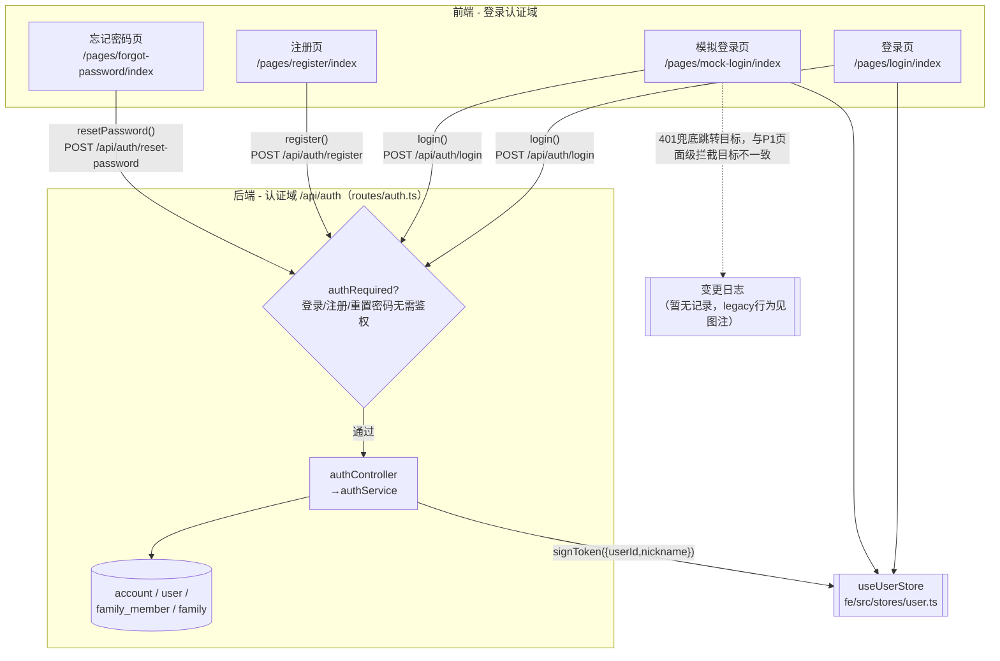
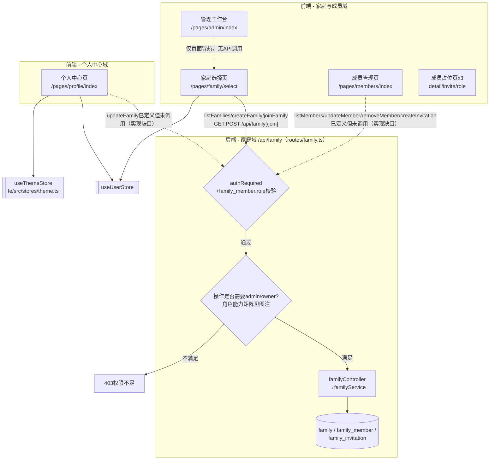
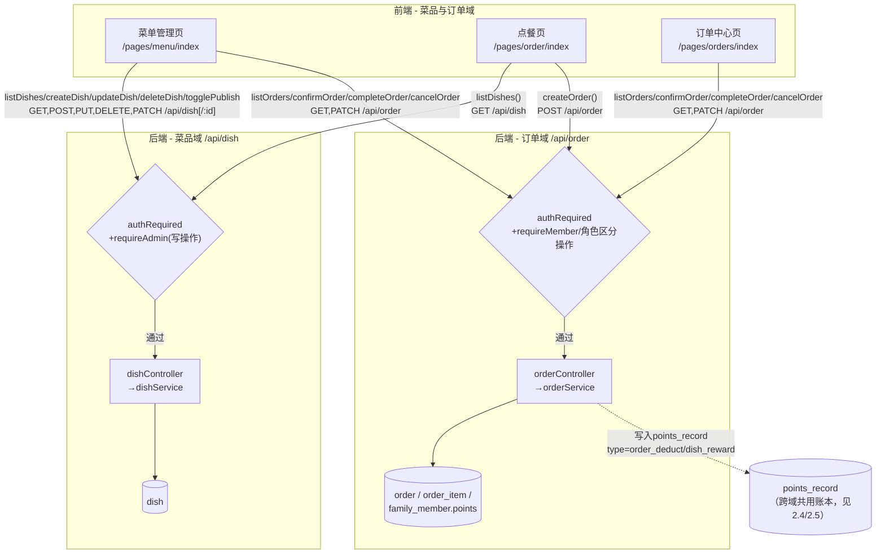
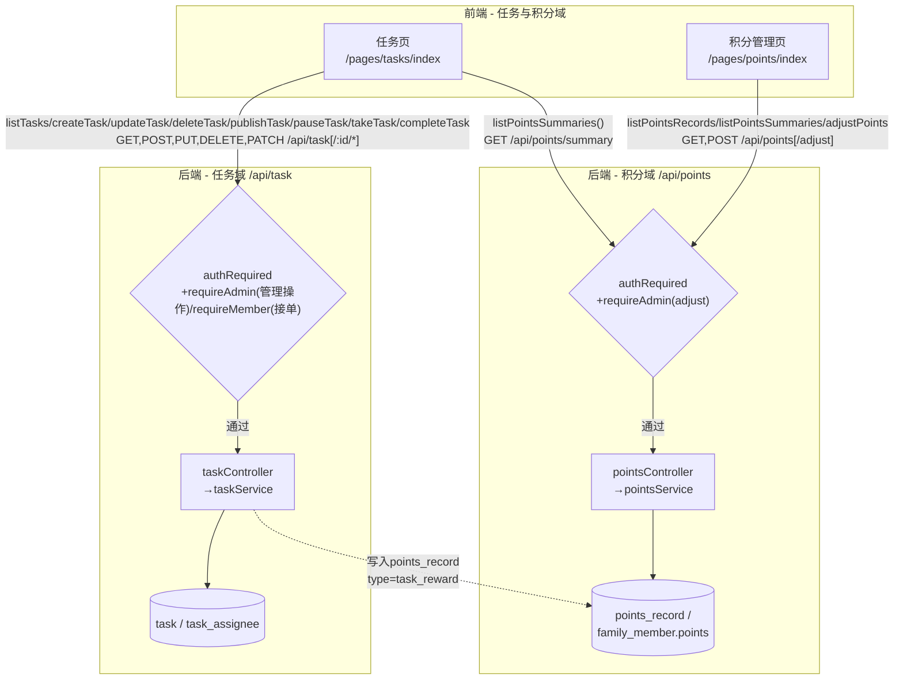
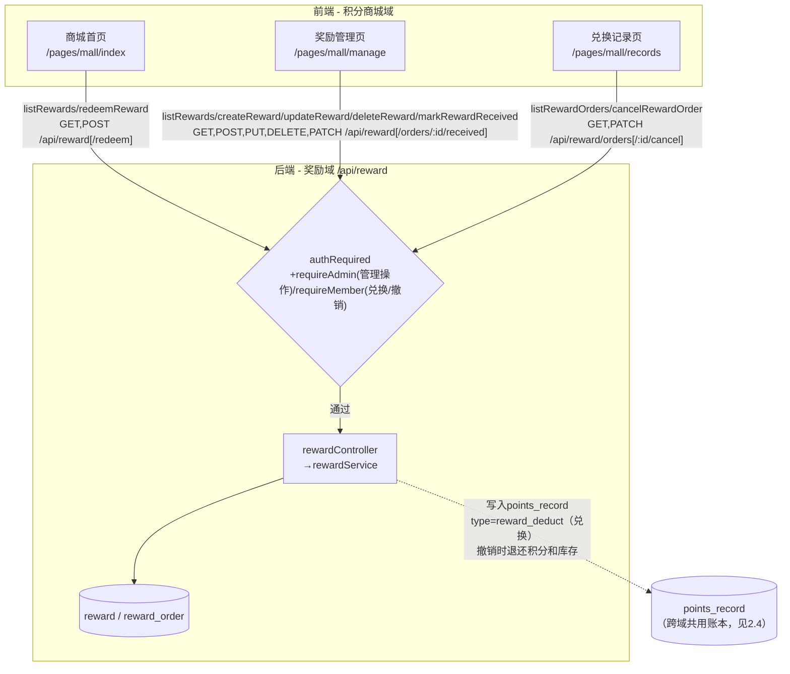

# jiawei（家味小札）项目云图

## 1. 范围与模式

**模式：项目级**（未指定具体文件）。**项目类型：全栈项目（Web 前端 + 后端 API 服务），置信度 `confirmed`**：前端 `fe/` 有 uni-app 页面路由（`fe/src/pages.json`）与应用入口（`fe/src/main.ts`），通过 `fe/src/utils/request.ts` 固定 `BASE_URL` 调用后端；后端 `server/` 有独立服务入口 `server/src/app.ts`，注册 Express 路由中间件、监听端口、连接 MySQL，无前端渲染职责。两者通过路由前缀一一对应（`server/src/app.ts:35-43`）。识别置信度高，未触发候选询问流程。

**扫描范围**：前端 `fe/src/{main.ts,App.vue,pages.json,manifest.json,pages/**,components/**,stores/**,api/**,utils/**}`、`fe/{vite.config.ts,tsconfig.json,package.json,index.html}`；后端 `server/src/{app.ts,routes/**,controllers/**,services/**,middlewares/**,utils/**,db/index.ts,config/index.ts,types/**}`、`server/{.env.example,docs/jiawei_db_schema.sql,docs/DATABASE.md,package.json,README.md}`。

**排除项**：`node_modules`、构建产物、`fe/.history`/`server/.history` 编辑器历史目录、二进制资源内部像素内容、Git 提交历史/diff/blame（仅读取当前分支名 `master` 用于变更日志）。两子项目均无测试目录/脚本，无测试覆盖可用。

**本次为 skill v2.0 格式下的首次基线重建**（原 12 节结构 → 现 4 节结构）：原「分页面数据流转图」「核心数据流 sequenceDiagram」「交互链路表」的调用链信息已并入下方关系图的边标注；原 `docs/cloud-map/` 下 6 个业务域子文档（含逐页面独立 Mermaid 图）内容已完全被下方关系图覆盖，**判定为冗余并移除**，避免同一调用关系在两处维护导致不一致。节点级「变更日志子节点」机制从本次基线之后的实际代码变更开始记录；本次梳理中发现的历史已知实现缺口/不一致（如成员管理页未接入已有 API）仍以关系图中的虚线边 + 标注呈现（不是真实的代码变更，不建立变更日志节点，避免把"静态发现"和"历史变更"混为一谈）。

---

## 2. 关系图

共 5 张图，按业务域拆分，每张图节点数均控制在 25 个以内。节点为具体页面/具体路由（不使用"N个页面"概括节点），用 subgraph 按前端/后端分层、按业务域分组，边标注真实调用的函数名+HTTP方法+路径，权限/鉴权判断统一用菱形节点。虚线边表示两类非常规关系：①已定义但未被实际调用的实现缺口；②跨域写入共享数据的关系。

### 2.1 登录认证域

- `GATE_AUTH` 为权限判断节点：登录/注册/重置密码三个接口均不需要 JWT 鉴权；`/api/auth/profile`、`/api/auth/logout` 需要 `authRequired`，因无复杂分支未展开为独立节点。`confirmed`。
- `P2` 的虚线标注：前端请求层 401 统一跳转到 `/pages/mock-login/index`（`fe/src/utils/request.ts:79-82`），而普通页面级拦截（如 `onShow` 判断未登录）跳转到 `/pages/login/index`，两处目标不一致。`mock-login/index.vue:2-5` 标注该页面"兼容保留"，但 401 跳转目标是否有意如此无法确认，标注 `inferred`（已反向检查 `request.ts` 历史注释和页面废弃说明，仍无法定论）。
- `authService.register` 内写入 `account`+`user`（事务），`resetPassword` 更新 `account` 密码哈希，均 `confirmed`，证据分别为 `server/src/services/authService.ts:179-214` 与 `authController.ts` 中 `resetPasswordHandler` 的路由引用（`routes/auth.ts:18`）；`resetPassword` 内部具体 SQL 字段未逐行核对，标注 `inferred`。

### 2.2 家庭与成员域 + 个人中心域

- `GATE_FAM`/`GATE_FAM2` 为两层权限判断：先校验 JWT 有效且用户是该家庭成员（否则 401/404），再校验操作是否需要 admin/owner（否则 403）。`confirmed`，来源 `server/src/services/familyService.ts:107-120,177-191,304-345`。
- 角色能力矩阵（`confirmed`）：

  | 操作 | owner | admin | member |
  |---|---|---|---|
  | 更新家庭信息 | ✓ | ✓ | ✗ |
  | 修改成员角色 | ✓ | ✗ | ✗ |
  | 移除其他成员 | 可移除admin/member | 可移除member | 仅可退出自己 |
  | 生成邀请码 | ✓ | ✓ | ✗ |
  | 自身被移除 | 不可被移除 | 可被owner移除 | 可被owner/admin移除 |

- `P7` 虚线标注（`confirmed`，非待确认）：成员管理页完全使用本地硬编码数组（`fe/src/pages/members/index.vue:346-351`），后端对应 4 个 API 均已实现（`server/src/routes/family.ts:30-34`）但未被调用，是前后端对接的实现缺口。
- `P8` 虚线标注（`confirmed`）：个人中心修改家庭名称只改前端内存中的 `families` 数组（`fe/src/stores/user.ts:144-147`），未调用已定义的 `updateFamily` API，刷新/重登后修改丢失。
- `P7X` 占位页三个（`members/detail`/`invite`/`role`）均为约17行的"功能开发中"提示，无生命周期数据加载、无 API 调用，故合并为一个节点，`confirmed`。
- `P6` 管理工作台本身不发起 API 请求，仅做 `userStore.isAdmin()` 判断后的页面导航，`confirmed`（`fe/src/pages/admin/index.vue:102-113`）。

### 2.3 菜品与订单域

- 订单状态机（`confirmed`，来源 `server/src/types/db.ts:83`、`orderService.ts:200-204,283-306,367-451`）：`pending→confirmed→completed`（管理员推进）；`pending/confirmed→cancelled`（管理员取消）；`pending→cancelled`（下单者本人取消自己的待接单订单）。
- 点餐页购物车（`cart`/`showCartModal`/`remark`）是页面本地状态，非全局 store，`confirmed`。
- 创建订单事务（`confirmed`，`orderService.ts:109-254`）：校验家庭成员关系 → 查询菜品库存/上架 → 查询积分余额 → 事务内扣库存+写order+写order_item+扣积分+写points_record。

### 2.4 任务与积分域

- 任务状态流转（`confirmed`，`taskService.ts:139-369,388-514`）：`draft→published→paused/completed`（管理员）；成员需在 `published` 且被指派才能 `takeTask`/`completeTask`；完成任务事务内增加积分并写 `points_record(task_reward)`。
- 积分流水类型枚举（`confirmed`，`server/src/types/db.ts:111-121`）：`order_deduct`/`dish_reward`（orderService）、`task_reward`（taskService）、`reward_deduct`（rewardService，见2.5）、`manual_add`/`manual_subtract`（pointsService 手动调账）。积分余额存于 `family_member.points`（家庭隔离），非 `user.points`。
- 管理员手动调账（`confirmed`，`pointsService.ts:90-125`）：事务更新 `family_member.points` + 写 `points_record`，修改对象为当前登录用户时前端同步 `userStore.points`。

### 2.5 积分商城域

- 兑换状态机（`confirmed`，`server/src/types/db.ts:189-190`，`rewardService.ts:409-495`）：`pending→received`（管理员确认领取）；`pending→cancelled`（用户本人撤销，事务内退还 `family_member.points` 和 `reward.stock`，写 `points_record`）。
- 兑换事务（`confirmed`，`rewardService.ts:278-364`）：查询奖励上架/库存 → 锁定并扣减积分 → 扣减库存 → 写 `reward_order` → 写 `points_record(reward_deduct)`。
- `P15` 管理员额外可见入口跳转自商城首页，该页面自身独立做管理员校验，不依赖商城首页的权限判断，`confirmed`。

---

## 3. 文件/符号索引

### 前端

- `fe/src/main.ts`：`createApp`
- `fe/src/stores/user.ts`：`useUserStore`（`login`/`applyLoginResult`/`fetchProfile`/`switchFamily`/`logout`/`isAdmin`/`updateFamilyName`）
- `fe/src/stores/theme.ts`：`useThemeStore`
- `fe/src/utils/request.ts`：`BASE_URL`、`request<T>`、`http.get/post/put/patch/delete`
- `fe/src/api/{auth,family,dish,order,points,task,reward}.ts`：各业务域 API 函数

### 后端

- `server/src/app.ts`：`app`、`bootstrap`
- `server/src/middlewares/auth.ts`：`authRequired`、`authOptional`（已定义但未被任何路由使用）
- `server/src/middlewares/response.ts`：`responseEnhance`（注入 `res.success`/`res.fail`，`res.fail` 不自动设 HTTP 状态）
- `server/src/middlewares/errorHandler.ts`：`notFound`、`errorHandler`
- `server/src/utils/jwt.ts`：`signToken`、`verifyToken`、`extractToken`（载荷仅 `{userId,nickname}`，不含角色）
- `server/src/services/permissionService.ts`：`getMemberRole`、`requireMember`、`requireAdmin`
- `server/src/db/index.ts`：`pool`、`query`、`queryOne`、`insert`、`update`、`testConnection`（mysql2连接池，无ORM）
- `server/src/controllers/*.ts`、`server/src/services/*.ts`：7 组 Controller/Service 对应 7 个业务域
- `server/docs/jiawei_db_schema.sql`：数据库表结构（13 张表）

---

## 4. 未确认项与扫描限制

| 检查项 | 结论 |
|---|---|
| 是否读取了测试文件 | 已检查，前后端均无测试目录/测试脚本 |
| 是否读取了配置文件/环境变量模板 | 已检查 `fe/vite.config.ts`/`manifest.json`/`pages.json`（无.env模板）及`server/.env.example`/`config/index.ts`（已列全部配置键，未抄录密钥值） |
| 是否追踪了第三方依赖内部实现 | 未追踪，仅确认 Express/uni-app/Pinia/mysql2/jsonwebtoken 的调用接口层 |
| `unconfirmed`：登录状态是否持久化 | 已查`App.vue`/`stores/user.ts`/`request.ts`/同域`theme.ts`持久化模式，均无`setStorageSync`调用，结论未实现持久化 |
| `unconfirmed`：`user.points`是否被扫描范围外程序维护 | 已查全部积分相关Service的SQL及生命周期入口，均未更新该字段，无法排除范围外维护 |
| `inferred`→`confirmed`：后端是否复核前端隐藏按钮的权限 | 反向检查管理类页面请求参数（无权限码）+ `permissionService.ts`数据库层独立校验，已升级为`confirmed` |
| `inferred`：401跳转`mock-login`是否为遗留代码 | 反向检查`request.ts`注释及`mock-login/index.vue:2-5`废弃说明，跳转目标是否有意如此无法确认，保留`inferred`（见2.1图注） |
| 项目类型识别置信度是否低于阈值 | 否，置信度高，未触发候选询问流程 |

---

## 修改历史

- 分支：master | 日期：2026-10-19 | 变更类型：新增 | 摘要：首次生成项目云图（skill v1.1-v1.3 的 12 节结构），覆盖前端 18 个页面与后端 9 个路由，分页面数据流转图拆分至 `docs/cloud-map/` 下 6 个业务域子文档。
- 分支：master | 日期：2026-10-19 | 变更类型：重构 | 摘要：按 skill v1.3 规则，第6节总体关系图改为按业务域拆分的2张详细图；第5/11节改为表格化精简写法。
- 分支：master | 日期：2026-10-19 | 变更类型：重构 | 摘要：按 skill v2.0 规则全面重建：文档结构由 12 节精简为 4 节（范围与模式/关系图/文件索引/未确认项）；关系图拆分为 5 张按业务域组织的图，节点粒度到具体页面/路由，边标注真实接口路径与函数名；原 `docs/cloud-map/` 下 6 个业务域子文档（含分页面 Mermaid 图和核心数据流 sequenceDiagram）内容已完全并入本次关系图，判定为冗余并移除；引入节点级「变更日志子节点」机制，自本次基线之后的实际代码变更开始记录（本次梳理发现的历史实现缺口仍以虚线边+图注呈现，不计入变更日志）。
